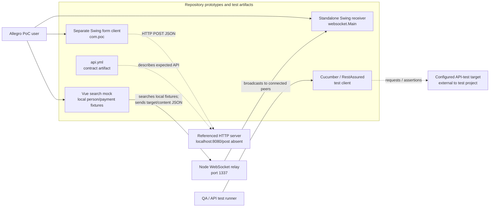
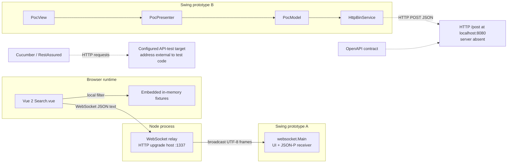
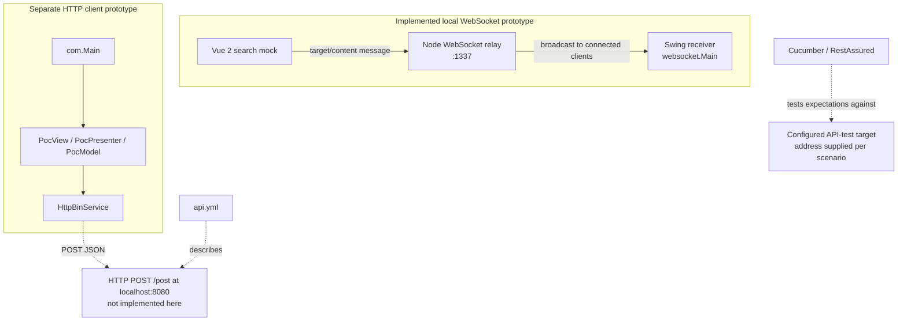
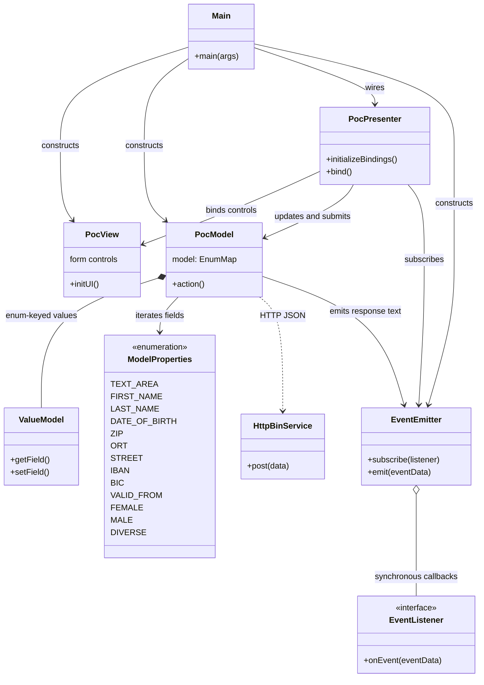
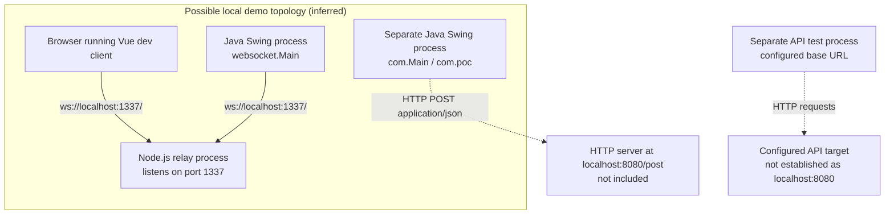
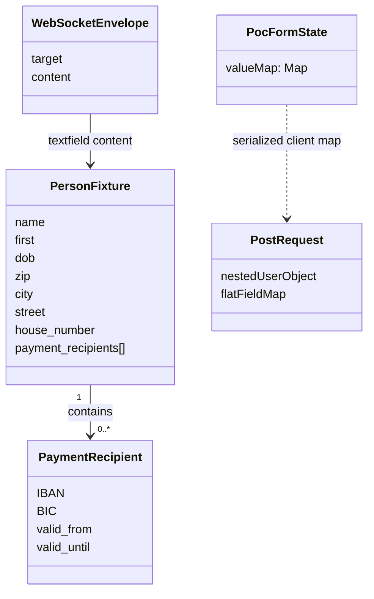
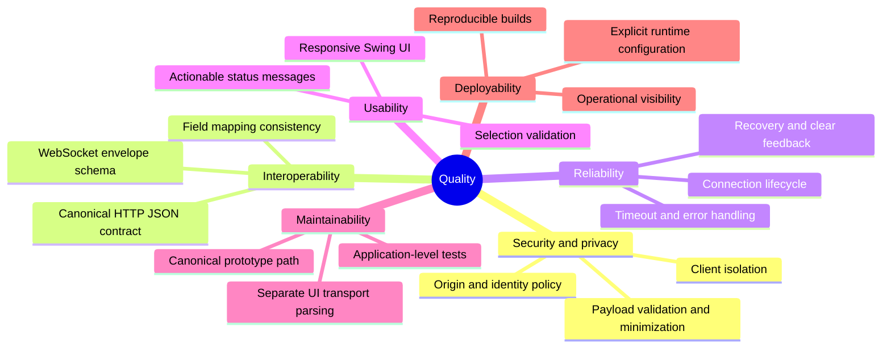

# Allegro Form/Search/WebSocket Proof of Concept — Architecture Documentation

**Version:** 1.0  
**Date:** 2026-10-21  
**Status:** Generated from repository analysis  
**Scope:** Allegro-oriented Swing/Vue/Node form, search, and WebSocket proof of concept

> **Evidence convention:** “Implemented” means visible in the inspected source; it does not imply production readiness or a working end-to-end deployment. “Test expectation” means behavior asserted by the Cucumber/API artifacts, not behavior implemented by a server. “Inferred” marks a reasonable interpretation not explicitly established by source. No HR application, database, durable persistence, backend search, or complete deployment is evidenced.

---

## Table of Contents

1. [Introduction and Goals](#1-introduction-and-goals)
2. [Constraints](#2-constraints)
3. [Context and Scope](#3-context-and-scope)
4. [Solution Strategy](#4-solution-strategy)
5. [Building Block View](#5-building-block-view)
6. [Runtime View](#6-runtime-view)
7. [Deployment View](#7-deployment-view)
8. [Crosscutting Concepts](#8-crosscutting-concepts)
9. [Architectural Decisions](#9-architectural-decisions)
10. [Quality Requirements](#10-quality-requirements)
11. [Risks and Technical Debt](#11-risks-and-technical-debt)
12. [Glossary](#12-glossary)

---

## 1. Introduction and Goals

### 1.1 Requirements Overview

The repository is a collection of small, overlapping Allegro-oriented prototypes and verification artifacts. The main implemented interaction is a browser mock that searches hard-coded person/payment fixtures and transfers selected data or text through a Node WebSocket relay to a separate Swing receiver. A second, independent Swing application demonstrates form binding and an outbound HTTP JSON request. The corresponding HTTP server is not present.

| Capability | Evidence and present boundary | Coverage |
|---|---|---|
| Person search and payment selection (CAP-001) | Vue `Search.vue` searches in-memory fixtures; it is not a backend directory or persistent search service. | Medium; mock only |
| Allegro form data handoff (CAP-002) | Vue sender, Node relay, and standalone Swing WebSocket receiver implement a local prototype path; field mapping and delivery are limited. | Medium |
| Desktop form capture and submission demonstration (CAP-003) | Separate `com.poc` Swing form binds fields and submits JSON to `localhost:8080/post`; endpoint is absent, so end-to-end behavior is unverified. | Low overall |
| WebSocket message relay (CAP-004) | Node service accepts clients on port 1337 and broadcasts incoming UTF-8 frames. | Medium; transport only |
| Prototype startup/build support (CAP-005) | Separate Java and Vue project configuration exists, but does not establish one integrated application or deployment. | Low |
| POST contract and test verification (CAP-006) | OpenAPI and Cucumber/RestAssured artifacts describe/assert a configured API. They do not implement it. | Medium for test tooling only |

No HR capability is supported by the analysis. Capability maturity is bounded prototype coverage, not production-readiness.

### 1.2 Quality Goals

The code assessment reports **65/100 overall health**, average code complexity **2.86/10**, and average logic complexity **1.50/10**. These are assessment metrics, not service-level objectives.

| Priority | Quality goal | Why it matters in this repository | Current observation |
|---|---|---|---|
| 1 | Safe message handling and privacy | Relay payloads can contain person/address/payment-like data. | Every received text frame is broadcast to all connected clients; there is no origin allowlist, authentication, payload schema validation, or recipient isolation. |
| 2 | Interoperability and contract clarity | Swing client, OpenAPI document, and API tests describe overlapping `/post` payloads. | `api.yml` nests request data under `user`; Swing and Cucumber clients send flat maps, and response expectations also differ. |
| 3 | Responsiveness and reliable UI behavior | Both desktop paths and browser messaging are interactive. | HTTP work blocks the Swing Event Dispatch Thread; WebSocket callbacks update Swing components off the EDT; Vue send/close/error states are incomplete. |
| 4 | Modifiability and testability | The repository has multiple independent prototype paths and no application-level desktop tests identified. | Search/UI, relay, and two Swing entry points are loosely coordinated; test project targets an external API rather than the Swing application code. |
| 5 | Failure transparency | Missing endpoints, null values, and network errors should not appear as silent or ambiguous outcomes. | HTTP timeouts/status handling, browser WebSocket error reporting, and receiver parse-error handling are limited or absent. |

### 1.3 Stakeholders

Stakeholders below are inferred from the artifacts and use cases; no organizational roles or formal requirements are supplied.

| Role | Relationship to the PoC | Expectations / concerns |
|---|---|---|
| Allegro PoC user | Uses the browser mock or a Swing prototype. | Search fixtures, select sample data, transfer it, and see form behavior. |
| Developer / maintainer | Works across Java, Vue, Node, and build artifacts. | Clear separation between the two Swing applications, reliable local startup, and understandable message/API contracts. |
| QA / API test author | Uses Cucumber and RestAssured test code. | A known endpoint and deterministic, structurally correct assertions. |
| Integration / security reviewer | Reviews WebSocket and HTTP boundaries. | Explicit routing, origin/authentication policy, schema, privacy, and endpoint ownership. |
| Operations / deployment owner | No deployment artifacts identify a current owner. | If this advances beyond a local demo, reproducible deployment and monitoring requirements must be established. |

---

## 2. Constraints

### 2.1 Technical Constraints

| Constraint | Evidence |
|---|---|
| Java Swing desktop clients | Java/AWT Swing is used by two separate entry points: `websocket.Main` and `com.Main`. |
| Java versions/builds differ | Root `pom.xml` configures Java source/target 22 and WebSocket/Tyrus/JSON-P dependencies. The isolated API-test Maven project targets Java 17. A unified multi-project build is not established. |
| Vue client stack | Vue 2, Vue CLI 4, Babel, ESLint, and the browser WebSocket API are declared/configured. |
| Node relay stack | Node.js built-in `http` module and the `websocket` npm package host the relay. The server manifest declares the dependency but no runtime script/test command was identified. |
| WebSocket address is local and fixed | Vue and Java receiver refer to `ws://localhost:1337/`; the Node relay listens on port 1337. No environment-based service discovery/configuration is evidenced. |
| HTTP target is separate and absent | `HttpBinService` targets `http://localhost:8080/post`. The repository does not include a server implementing this endpoint. |
| API spec is not executable behavior | `api.yml` is an OpenAPI 3.0.1 artifact. Cucumber/RestAssured is a separate test client. Neither supplies the `/post` server. |
| No persistence technology | No database, table mapping, durable store, or server-side repository is identified. Vue records and API test data are fixtures/in-memory state. |
| Local prototype boundaries | Source uses local host/port addresses. No production configuration, container, cloud, or deployment descriptor is evidenced. |

### 2.2 Organizational Constraints

No delivery process, operational ownership, compliance policy, availability target, security classification, or formal acceptance criteria are evidenced. The architecture must therefore be treated as an analysis of code rather than confirmation of organizational intent.

The Cucumber/API test project has its own Maven lifecycle and Java target. The repository analysis identifies no automated tests for the desktop application code. Test expectations for an external endpoint do not substitute for application tests.

### 2.3 Conventions and Observed Contracts

- The UI includes German labels such as **Suchen**, **Nach ALLEGRO übernehmen**, and **Anordnen**.
- The Vue client emits WebSocket JSON envelopes with `target` and `content`; observed targets include `textfield` and `textarea`. This is an implicit convention, not a validated/versioned schema.
- Search criteria are name, first name, postal code, city, street, and house number. Populated criteria are ORed; textual comparisons are case-insensitive substrings, while postal code is exact.
- The `com.poc` form model uses `ModelProperties` enum keys and serializes values into a string-valued map.
- The API tests use fixtures and Cucumber feature declarations. The step called “previously submitted” loads a local fixture; it does not perform a prior request or verify persistence.
- The OpenAPI request shape and client/test payloads are not aligned: the contract describes a nested `user` object, whereas the Swing and test clients send flat maps.

---

## 3. Context and Scope

### 3.1 Business Context

The user-facing purpose visible in code is experimentation with person/address/payment-like form data, local fixture search, and moving selected data into a desktop form. The term “Allegro” is used in the UI/context; the repository does not demonstrate a production Allegro integration.



**External interfaces and status**

| Partner / boundary | Interface | Description and status |
|---|---|---|
| Vue client ↔ Node relay | WebSocket, `ws://localhost:1337/` | Implemented local transport. Vue sends text/JSON; relay broadcasts frames to all connected clients, including sender. |
| Node relay → Swing receiver | WebSocket broadcast | Implemented when the receiver is connected. Receiver maps only recognized targets and selected fields. |
| `com.poc` Swing client → `/post` | HTTP POST, `application/json`, `http://localhost:8080/post` | Client implementation is present; server is not present in this repository. |
| OpenAPI document | `api.yml` | Describes a `/post` contract; it does not implement an endpoint. |
| Cucumber/RestAssured harness → configured API | HTTP | Test requests and assertions target a separately configured endpoint. The test project contains no server. |

### 3.2 Technical Context



The two Swing applications are independent. The **Anordnen** button in `websocket.Main` only logs a click; it is not wired to the `com.poc` model or HTTP adapter. The relay on port 1337 is not the HTTP server on port 8080.

---

## 4. Solution Strategy

### 4.1 Technology Decisions Observed

These are technologies present in source/configuration; where intent is unknown, rationale is marked as an interpretation rather than an established decision.

| Area | Technology / pattern | Evidence and rationale visible in code |
|---|---|---|
| Desktop UI | Java Swing/AWT | Provides two independent form prototypes. |
| WebSocket desktop client | Java WebSocket API, Tyrus, JSON-P | `websocket.Main` connects to the local relay and parses incoming messages. |
| Browser UI | Vue 2 single-file components, Vue CLI 4 | `Search.vue` implements local search, selection, and message sending; `App.vue` is the shell. |
| Relay | Node.js `http` + `websocket` package | A small process accepts WebSocket connections and fans out UTF-8 messages. |
| Separate HTTP client | `HttpURLConnection` and JSON-P | `HttpBinService` creates a JSON POST for the `com.poc` form. |
| Contract and tests | OpenAPI 3.0.1, Cucumber, JUnit 5, RestAssured, AssertJ | Describes and tests a separately configured API target; does not provide a server. |
| `com.poc` application organization | Partial MVC-style presenter coordination and synchronous observer | View, presenter, model, and event emitter have separate responsibilities within this application only. |

### 4.2 Top-Level Decomposition

This repository is **not one layered production service**. It contains:

1. A Vue local-fixture search and message producer.
2. A Node WebSocket broadcast relay.
3. A standalone Swing WebSocket receiver (`websocket.Main`).
4. A separate Swing MVC-style HTTP client (`com.Main` and `com.poc`).
5. An OpenAPI contract and a separate API test client for an endpoint not implemented here.

The only cross-process path demonstrated end-to-end in source is the local WebSocket handoff, subject to all components being launched and connected. The HTTP submission path ends at an absent endpoint. There is no database, backend search service, or integrated deployment.

### 4.3 Quality Approach

| Quality goal | Observed approach or required follow-up |
|---|---|
| Modifiability | The `com.poc` form separates view, presenter, model, and HTTP adapter; this separation does not extend to the combined `websocket.Main` UI/transport/parser class. |
| Testability | An isolated API test client exists, but it targets an external endpoint. Add focused model, serialization, parser, and HTTP-client tests if application behavior is to be maintained. |
| Reliability | Current integration code is synchronous and has limited timeout/status/error handling. Explicit lifecycle, failure states, and resource cleanup are not consistently implemented. |
| Security/privacy | Relay broadcast is unrestricted in the observed code; origin, identity, routing, message validation, and payload minimization need definition before shared use. |
| Interoperability | Agree one request/response JSON contract and validate both Swing and test payloads against it. Define a WebSocket envelope schema as well. |

---

## 5. Building Block View

### 5.1 Level 1: System Context and Runtime Paths

At the highest level, the repository is a prototype workspace rather than a single application boundary. The central implemented relationship is Vue → relay → Swing receiver. The form-submission client and API test artifacts are separate.



### 5.2 Level 2: Major Components

| Building block | Responsibility | Key boundary |
|---|---|---|
| Vue shell and `Search.vue` | Render mock form; search fixtures; maintain person/payment selection; send text or selected data. | Browser WebSocket API; no remote search call. |
| Embedded fixture state | Sample people and payment-recipient records held in component memory. | Lost with component/runtime; not an authoritative data store. |
| Node `WebsocketServer.js` | Accept WebSocket peers and broadcast incoming UTF-8 frames to all connected clients. | Port 1337; does not interpret business payload. |
| `websocket.Main` | Independent Swing form, WebSocket endpoint, JSON-P envelope parsing, and field mapping. | Connects to port 1337; mapping is embedded in the class. |
| `com.Main` | Composition root for the other Swing application. | Creates `PocView`, `PocModel`, `PocPresenter`, and `EventEmitter`. |
| `PocView` | Builds personal/address/payment/gender/text controls and submit button. | Swing presentation only. |
| `PocPresenter` | Binds controls to model, invokes submission, handles response events and reset. | UI/model coordination; network call currently blocks the UI action path. |
| `PocModel` | Stores enum-keyed values, serializes all fields as strings, invokes HTTP adapter, emits response-derived text. | No persistence or robust business validation. |
| `EventEmitter` / `EventListener` | Synchronous in-process observer mechanism. | Not a distributed event bus; listener exceptions are not isolated. |
| `HttpBinService` | POST JSON map to `localhost:8080/post` and read response. | Server implementation absent. |
| `api.yml` and API test project | Specify an API and construct/assert requests. | Specification/test tooling only; no endpoint implementation. |

### 5.3 Level 3: `com.poc` Component/Class Structure



The UML analysis counts 18 Java class declarations (including nested declarations), one interface, and one enum across the analyzed application and test source. This diagram shows only the `com.poc` path. `websocket.Main` is a separate application and combines Swing controls, WebSocket callbacks, and JSON parsing. The API test support classes (`PostStepDefinitions`, `ApiClient`, `TestContext`, and `TestDataBuilder`) are test-only and are intentionally not drawn as runtime components.

---

## 6. Runtime View

### 6.1 Key Scenarios

#### Scenario A: Search and transfer selected fixture data

The Vue client scans in-memory fixtures when the user clicks **Suchen**. Any populated criterion may match (OR semantics); text fields are case-insensitive substring checks and postal code is exact. A person and payment beneficiary may be selected, but the code does not require either selection before transfer. It sends a `textfield` target/content envelope. The relay broadcasts it to all connected peers; the Java receiver maps recognized fields if connected.

```mermaid
sequenceDiagram
    actor User
    participant Vue as Vue Search.vue
    participant Relay as Node relay :1337
    participant Java as websocket.Main endpoint
    participant Form as Swing receiver form

    User->>Vue: Enter criteria; click Suchen
    Vue->>Vue: Search embedded fixtures (OR criteria)
    Vue-->>User: Show matching rows or empty list
    opt User selects a result and beneficiary
        User->>Vue: Select person/payment row
        Vue->>Vue: Store current selection
    end
    User->>Vue: Click Nach ALLEGRO übernehmen
    Vue->>Relay: JSON {target:"textfield", content:...}
    Relay->>Relay: Broadcast UTF-8 frame to all peers
    Relay-->>Java: Same broadcast, if receiver connected
    Java->>Java: Parse target/content and recognized fields
    Java->>Form: Populate mapped fields
    Note over Vue,Java: Empty/stale selections are possible;<br/>no schema, delivery guarantee, or recipient isolation
```

Additional source-proven interaction: each Vue textarea model change sends a `textarea` target message without debounce. The relay broadcasts it and the receiver places the content into its text area. There is no offline queue or persistence.

#### Scenario B: Submit and reset the separate `com.poc` Swing form

```mermaid
sequenceDiagram
    actor User
    participant View as PocView
    participant Presenter as PocPresenter
    participant Model as PocModel
    participant HTTP as HttpBinService
    participant API as External /post endpoint
    participant Events as EventEmitter

    User->>View: Edit text / gender fields
    View-->>Presenter: Document/change callbacks
    Presenter->>Model: Update ValueModel fields
    User->>View: Click Anordnen
    View->>Presenter: Button action
    Presenter->>Model: action()
    Model->>Model: Convert every ModelProperties value to String
    alt A value is null
        Model-->>Presenter: Conversion failure before HTTP
    else All values stringify
        Model->>HTTP: post(string-valued map)
        HTTP->>API: POST /post (application/json)
        API-->>HTTP: Response (requires external server)
        HTTP-->>Model: Response body if read normally
        Model->>Events: Emit body or "Failed operation"
        Events-->>Presenter: Synchronous callback
        Presenter->>View: Display event and reset controls
    end
    Note over HTTP,API: Endpoint absent in this repository;<br/>HTTP status is not the success decision
```

The sequence describes the client code path, not a guaranteed successful transaction. The HTTP client has no configured timeouts, reads only the success stream, and has fragile cleanup/error handling. Empty-stream and transport/status failures may throw before an outcome event. Submission runs synchronously from the Swing action path and can freeze the UI.

#### Scenario C: Cucumber API test flow (test expectation only)

1. Cucumber initializes per-scenario context and a configured base URL.
2. Step definitions load a fixture map or fields from a data table.
3. An empty request map is sent as literal `{}` by `postEmpty`, not as a zero-byte body; otherwise a flat JSON map is sent.
4. RestAssured calls the configured external target.
5. Steps assert status, body/field value, or content type.

The test suite expects HTTP 200 for complete, partial, and empty-object cases in its scenarios. These expectations do not demonstrate actual endpoint behavior. The “previously submitted” step only loads fixture data; it does not issue a prior POST or establish persistence. One field assertion may fall back to searching the whole response body when the expected path is missing.

### 6.2 Business Workflow Summary

| Workflow | Evidence class | Outcome / important branch |
|---|---|---|
| Search and transfer person/payment data (PROC-001 / WF-001) | Implemented client/relay/receiver path | Empty results or missing selection do not prevent transfer; a stale/empty selection may be sent. |
| Relay textarea edits (PROC-002) | Implemented client/relay/receiver path | Every change is sent; no debounce, persistence, queue, or user-facing recovery. |
| Submit and reset `com.poc` form (PROC-003 / WF-002) | Client implemented; endpoint absent | Null value can fail before HTTP. If a normal response event occurs, text is displayed and controls reset. |
| Cucumber POST contract scenario (PROC-004) | Test expectation only | Assertions target an external/configured endpoint; they do not prove a server implementation. |

---

## 7. Deployment View

### 7.1 Infrastructure and Runtime Topology

No production deployment or infrastructure configuration is present in the analyzed artifacts. The following diagram is an **inferred local demonstration topology from hard-coded addresses**, not a verified deployment recipe:



The WebSocket clients connect independently; the server broadcasts to active peers. `WebsocketSwingClient.launch` targets the WebSocket Swing entry point. `com.Main` starts the separate MVC-style HTTP client. No evidence ties these two entry points into one executable application. The API test project has its own Java 17 Maven configuration.

### 7.2 Deployment Considerations

- Treat local host/port values as prototype defaults, not production configuration.
- The Node process is not an HTTP `/post` API implementation; a separate server must be identified if the HTTP client or API tests are expected to run successfully.
- The Vue development build configuration and Java Maven configuration do not describe an integrated release pipeline.
- No container images, orchestration descriptors, TLS termination, secrets management, service discovery, database deployment, monitoring, backup, or scaling configuration were identified.
- Before any shared deployment, restrict WebSocket origins and clients, authenticate as appropriate, validate payload size/schema, route messages to intended sessions, and avoid exposing person/payment-like data to every peer.
- Establish supported JDKs, start/stop procedures, environment configuration, and reproducible build/test commands for each independent project.

---

## 8. Crosscutting Concepts

### 8.1 Domain and Data Model

There is no persistent domain model or relational schema in the repository. The observed in-memory structures are:



`PersonFixture` and `PaymentRecipient` describe the Vue sample data conceptually, not database entities. `PocFormState` is an enum-keyed Java map whose values are wrapped in `ValueModel`; its serialized values become strings. `api.yml` describes request nesting that differs from the flat map sent by clients/tests. No canonical shared schema is enforced.

### 8.2 Error Handling

- **Vue WebSocket:** `onopen` is handled, but there is no complete open/error/close state model, send readiness guard, reconnect policy, or guaranteed component teardown. `disconnect()` assumes a socket exists.
- **Node relay:** message format/content is not validated. A connection list is maintained and frames are broadcast; no explicit delivery acknowledgement, retry, or payload-specific error response is evidenced.
- **WebSocket Swing receiver:** parsing and Swing updates occur in the callback path; malformed messages and unknown fields have no robust recovery policy. Unknown targets have no action.
- **Swing HTTP path:** missing timeouts, success-stream-only reads, weak cleanup, synchronous EDT I/O, and exceptions surfaced as runtime failures can produce a frozen UI or unclear outcome.
- **Model conversion:** null values can throw during `toString()` before a request is sent.
- **Test harness:** assertions have inconsistencies described in §6.1 and §11; tests describe target behavior and cannot compensate for a missing server.

### 8.3 Logging and Monitoring

The analyzed source includes diagnostic console output in some paths, but no structured logging policy, correlation IDs, metrics, tracing, health checks, alerting, or operational dashboards are evidenced. The relay sends person/payment-like payloads; full payload logging should be avoided. Monitoring requirements and log-retention/privacy rules are not specified.

### 8.4 Security and Privacy

The assessment marks unrestricted WebSocket broadcast as a **severe (criticality 4)** issue: the server accepts origins without an allowlist and sends every received message to all connected clients. Payloads may include person, address, and payment details. This is unsuitable for shared/production use without controls.

No authentication, authorization, recipient/session routing, message schema validation, message-size constraints, encryption beyond the local `ws://` prototype URL, or data-retention policy is evidenced. This is an absence of observed controls, not proof of a particular threat model. Minimize payloads, use secure transport and suitable identity/access controls for any non-local deployment, and isolate demo-only settings.

### 8.5 Persistence and State

- Vue search fixtures and selection state are held in memory.
- The Node relay stores active connection references but no message history or application data.
- `PocModel` stores mutable form values during the client process.
- Cucumber test personas are local fixtures; “previously submitted” does not imply an existing persisted record.
- No database, durable queue, backup, or persistence API is evidenced.

### 8.6 Validation and Business Rules

Ten business rules were identified across six domains. No authorization, calculation, or implemented temporal rules were found.

| Rule(s) | Observed behavior |
|---|---|
| BR-001 / BR-002: search | Any matching populated criterion is sufficient (OR). Name/address text uses case-insensitive substring matching; postal code uses exact equality. No trimming, accent normalization, prefix matching, or DOB search. |
| BR-003 / BR-004: handoff and payment selection | Selected person and current payment record are copied into the transfer; selection is not required. `valid_from` / `valid_until` are not evaluated and bank details are not validated. Java maps only name, first, DOB, ZIP, city, street, house number, IBAN, BIC, and valid-from. |
| BR-005: textarea | Every text change is sent; no debounce or persistence. |
| BR-006: gender UI | Swing radio buttons are mutually exclusive and default/reset to female. This is UI behavior, not server validation. |
| BR-007 / BR-009: form submission | All `ModelProperties` are stringified and posted as JSON; null values can fail before network I/O. No user-facing required-field validation is established. |
| BR-008: response handling | A non-empty response body is treated as success text; empty normal response becomes `Failed operation`. HTTP status is not the success criterion. |
| BR-010: API tests | Cucumber expects outcomes from an external `/post` service, including partial and empty JSON-object requests. These are tests, not implemented business rules. |

---

## 9. Architectural Decisions

The repository does not contain explicit ADRs. The following are **observed architectural decisions/patterns inferred from code**, not claims that a design authority intentionally approved them.

### ADR-001: Use a WebSocket broadcast relay for the handoff prototype

**Status:** Implemented (observed)  
**Context:** Vue and a Java desktop client need a live message path in the prototype.  
**Decision observed:** Vue sends text frames to a Node WebSocket relay on port 1337; the relay broadcasts each UTF-8 message to every connected client, including the sender.  
**Consequences:** Small and simple local fan-out; no domain processing or history. Every connected client can receive messages not addressed to it, and there are no evidenced delivery guarantees, identity controls, or schema validation.

### ADR-002: Keep the Vue search dataset in the browser

**Status:** Implemented (observed)  
**Context:** The mock needs searchable person/payment examples.  
**Decision observed:** Fixtures and OR-based matching are embedded in `Search.vue`; no search endpoint is called.  
**Consequences:** Self-contained demo behavior with no service dependency; data is non-authoritative, process-local, and not persistent or scalable as a directory.

### ADR-003: Maintain two separate Swing entry points

**Status:** Implemented (observed; canonical path unresolved)  
**Context:** Similar form concepts appear in separate WebSocket and HTTP prototypes.  
**Decision observed:** `websocket.Main` receives relay messages; `com.Main` builds the `com.poc` presenter/model/HTTP client. The launch file targets the former.  
**Consequences:** Each path can evolve independently, but users and maintainers can confuse their behavior; no unified flow is established. The WebSocket form's submit button is a console-print stub.

### ADR-004: Treat `/post` as an external boundary

**Status:** Endpoint absent from this repository  
**Context:** The Swing client and API artifacts refer to a POST endpoint at port 8080.  
**Decision observed:** The repository contains a client, OpenAPI description, and test client, but no endpoint server.  
**Consequences:** Submission and test behavior cannot be confirmed end-to-end locally from repository code alone. Contract and payload mismatches remain unresolved.

### ADR-005: Serialize form state as string-valued properties

**Status:** Implemented (observed)  
**Context:** The `com.poc` model represents fields with enum keys and typed value wrappers.  
**Decision observed:** Submission iterates every property and converts each value to a string map entry before JSON encoding.  
**Consequences:** A uniform simple payload representation; null values fail before request construction and typed values/validation semantics are lost at the HTTP boundary.

---

## 10. Quality Requirements

### 10.1 Quality Tree



### 10.2 Quality Scenarios

No numeric production targets or SLAs are specified. Measures below are verification criteria to define/automate, not existing guarantees or previously agreed thresholds.

| ID | Attribute | Scenario | Observable acceptance measure |
|---|---|---|---|
| QS-1 | Security / privacy | Two clients connect to the relay and one sends a person/payment-like message. | Only the authorized intended recipient receives it; unauthorised origins/clients are rejected according to a documented policy. Current behavior broadcasts to all peers. |
| QS-2 | Interoperability | A Swing request, OpenAPI schema, and Cucumber fixture represent the same form. | One canonical schema validates all three; required fields and response paths agree. Current shapes disagree. |
| QS-3 | Responsiveness | The `/post` server is slow or unavailable while the user submits. | Swing remains interactive and exposes pending/failure state; no I/O is performed synchronously on the EDT. Current implementation blocks. |
| QS-4 | Recoverability | WebSocket relay disconnects, rejects a frame, or receives malformed JSON. | Browser and desktop clients show/handle connection and parse failures without stale unintended sends or partial UI updates. Current recovery is incomplete. |
| QS-5 | Data correctness | A user searches, changes person, and transfers without selecting a new payment beneficiary. | Handoff uses explicitly validated current selections and does not accidentally reuse stale state. Current code may retain stale selection. |
| QS-6 | Testability | A field mapping or model serialization rule changes. | Automated application-level tests cover model/serialization/parsing and distinguish client tests from external API contract tests. Desktop application tests were not identified. |
| QS-7 | Deployability | A maintainer builds and starts each intended prototype in a clean environment. | Documented Java versions, independent build commands, endpoints, and startup sequence reproduce the chosen path. A canonical integrated path is not currently established. |

---

## 11. Risks and Technical Debt

### 11.1 Technical Risks

| Risk | Likelihood / probability | Impact | Evidence and mitigation |
|---|---|---|---|
| Cross-client disclosure of messages containing person/payment-like details | High if relay is used by multiple clients; lower in an isolated one-user local demo | High | Relay broadcasts to every connected peer without origin allowlist or client authentication. Add origin/authentication controls, payload limits/schema validation, and recipient/session routing before shared use. |
| Ambiguous HTTP contract causes integration failure | High | High | `api.yml` uses nested request data; Swing and tests use flat maps; response nesting also differs. Select one contract and validate clients/tests against it. |
| HTTP flow appears complete although no endpoint exists | High unless external dependency is supplied | High | Port-8080 server is absent. Identify/provision it or label the flow as client-only; do not infer behavior from test assertions. |
| Swing UI freezes or mishandles response failures | Medium to high when endpoint is slow or unavailable | Medium/high | Synchronous HTTP on EDT, no timeouts, success-stream-only handling, and fragile cleanup. Move I/O off EDT and report typed success/failure results. |
| Unsafe Swing updates from WebSocket callback thread | Medium | Medium | WebSocket callback writes controls directly. Dispatch UI updates to EDT and test parsing independently. |
| Stale/empty search selection is transferred | Medium | Medium | No required-selection guard; current person/beneficiary state may persist across searches or person changes. Reset dependent state and validate before send. |
| API test results misrepresent empty-body, persistence, or field behavior | Medium | Medium | `postEmpty` sends `{}`; “previously submitted” loads a fixture; a field assertion may search the entire body. Correct names and structural assertions. |
| Build/test fragmentation prevents reproducible verification | Medium | Medium | Separate Java 22 application and Java 17 test project; no unified lifecycle/canonical entry point. Document supported commands/targets or intentionally aggregate projects. |

### 11.2 Technical Debt

| ID | Type | Description | Priority / impact | Estimated effort |
|---|---|---|---|---:|
| TD-001 | Design debt | Canonical application path is unclear across two Swing entry points, Vue mock, relay, and API artifacts. | High; priority 5 | 8 h |
| TD-002 | Code/design debt | `websocket.Main` combines UI, transport callbacks, parsing, state, and field mapping. | Medium; priority 3 | 6 h |
| TD-003 | Test debt | No automated tests identified for desktop application code; external API Cucumber tests are not a substitute. | Medium; priority 4 | 8 h |
| TD-004 | Infrastructure/build debt | Separate Java targets and build/test lifecycles are not documented as one reproducible workflow. | Medium; priority 3 | 5 h |
| TD-005 | Code debt | `ViewData` is an unused empty placeholder. | Low; priority 1 | 0.5 h |

### 11.3 Assessment Issues and Improvement Recommendations

The code assessment identified **11 issues: 0 criticality-5, 2 severe (4), 5 normal (3), and 4 minor (2)**, alongside five debt items and four enhancements.

**Highest-priority findings**

- **ISS-004 (severe):** Unrestricted WebSocket broadcast; add origin allowlisting/authentication for non-local use, validate envelope and payload size, route to intended sessions, and avoid logging full payloads.
- **ISS-007 (severe):** OpenAPI and test payload/response shapes disagree; establish one executable request/response contract and align Swing, tests, and examples.
- **ISS-003 (normal):** Synchronous HTTP blocks the Swing EDT; use a worker/executor and render pending/success/failure states on the EDT.
- **ISS-005 (normal):** WebSocket callback updates Swing components off the EDT; parse off-thread and dispatch UI changes with `SwingUtilities.invokeLater`.
- **ISS-002 (normal):** HTTP client lacks timeouts and reliable resource/error-stream handling; return status/body and guarantee cleanup.
- **ISS-006 (normal):** Vue WebSocket lifecycle/send failures are incomplete; handle open/error/close, guard sends, make disconnect idempotent, and close on component destruction.
- **ISS-011 (minor):** Handoff is enabled without a selected person/payment record; validate before sending.
- **ISS-008/009/010:** Correct empty-body semantics, fixture-only “previously submitted” wording, and response field assertions.
- **ISS-001 (minor):** Null model values can cause `NullPointerException` during submission; define defaults and validate required fields.

**Recommended sequence**

1. Restrict/isolate the broadcast relay and choose the canonical JSON HTTP contract.
2. Decide which prototype path is canonical and document the actual external endpoint dependency.
3. Remove blocking I/O and off-EDT updates; add explicit network and UI error states.
4. Guard selection and define beneficiary validity/field mapping requirements.
5. Add application-level unit/integration tests and make API test fixtures/assertions structurally accurate.
6. Document build targets/startup and consolidate or clearly label separate project lifecycles.

---

## 12. Glossary

### 12.1 Domain and UI Terms

| Term | Definition |
|---|---|
| Allegro | Label used by the prototype for the form/data handoff context. No production Allegro service integration is evidenced. |
| Person fixture | Hard-coded sample person/address record held by the Vue component for local search. |
| Payment beneficiary / `zahlungsempfaenger` | Payment-related record associated with a person in the sample data; selection is passed through but not validated for active dates or banking correctness. |
| Search criterion | One of last name, first name, postal code, city, street, or house number. Matching is OR-based. |
| Handoff | Sending the selected Vue record or textarea content through the WebSocket relay to a connected desktop client. |
| `Suchen` | German UI label for “Search.” |
| `Nach ALLEGRO übernehmen` | German UI label for transferring selected data to the prototype form. |
| `Anordnen` | German button label used in the Swing forms. In `com.poc` it invokes the HTTP submission flow; in `websocket.Main` it only logs a click. |

### 12.2 Technical Terms

| Term | Definition |
|---|---|
| WebSocket relay | Node process on port 1337 that broadcasts incoming UTF-8 frames to connected peers; it does not interpret application semantics. |
| `target/content` envelope | Implicit JSON message convention where `target` selects handling (`textfield` or `textarea`) and `content` carries data. |
| Swing MVC-style path | The separate `com.poc` view/presenter/model arrangement. It is partial and specific to that application. |
| EventEmitter | Synchronous in-process observer utility used by `PocModel` to notify its presenter; not a distributed message broker. |
| `/post` endpoint | Referenced HTTP POST API at `localhost:8080/post`; server implementation is absent from the analyzed repository. |
| API test expectation | A Cucumber/RestAssured assertion against a configured target; not proof that a corresponding server behavior exists. |
| EDT | Swing Event Dispatch Thread, responsible for UI events and component updates. Current HTTP and WebSocket paths have EDT-threading concerns. |
| Durable persistence | Database or other long-lived storage. None is evidenced here. |

---

## Appendix

### A. File Inventory

The documentor analysis inventoried **28 relevant source, test, and configuration files** (generated output, dependencies, images, and workspace scaffolding excluded).

| Category | Count | Languages / examples |
|---|---:|---|
| Business | 3 | Java (`PocModel`), Vue (`Search.vue`), Gherkin feature |
| Technical | 21 | Java, JavaScript, Vue, XML, YAML, JSON, properties |
| Mixed | 4 | Java HTTP adapter/presenter/WebSocket UI and Java test step definitions |
| **Total** | **28** | Java, JavaScript, Vue, XML, YAML, JSON, Gherkin, properties |

### B. Analysis Metadata and Sources

- **Foundational analysis timestamp:** 2026-10-21T11:44:00Z
- **Business rules:** 10 rules across six domains; two business workflows
- **Architecture analysis:** 11 components across five logical zones; one referenced HTTP integration, server absent
- **UML:** 3 class diagrams, 3 sequence diagrams, 1 component diagram, 1 use-case diagram; 18 Java class declarations, 1 interface, 1 enum
- **BPMN/workflow analysis:** 4 workflows: 3 source-proven client/test-client flows and 1 external API expectation
- **Capability mapping:** 3 domains, 6 top-level capabilities, 15 sub-capabilities; 28 files mapped
- **Code assessment:** health 65/100; 11 issues; 5 technical-debt items; 4 enhancements
- **Analysis agents represented:** documentor, business-rules, code-assessment, UML, BPMN, architecture, capability-mapping
- **Artifacts synthesized:** `.geninsights/analysis/analysis_results.json`, `business_rules.json`, `code_assessment.json`, `architecture_analysis.json`, `capability_mapping.json`, `uml_analysis.json`, `bpmn_workflows.json`, and all seven corresponding `.geninsights/docs/*.md` files.

### C. Diagram Index

This document includes 9 Mermaid diagrams: business context, technical context, level-1 runtime boundaries, `com.poc` class structure, WebSocket handoff sequence, HTTP submission sequence, inferred local topology, conceptual data model, and quality tree.

---

*Automatically synthesized from source-code analysis and prior GenInsights outputs. Interpretations and absent components are explicitly qualified; this document does not assert production readiness or deployment.*
