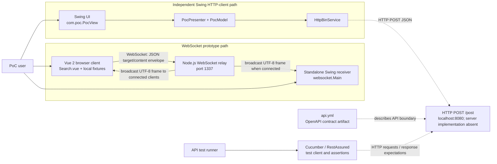
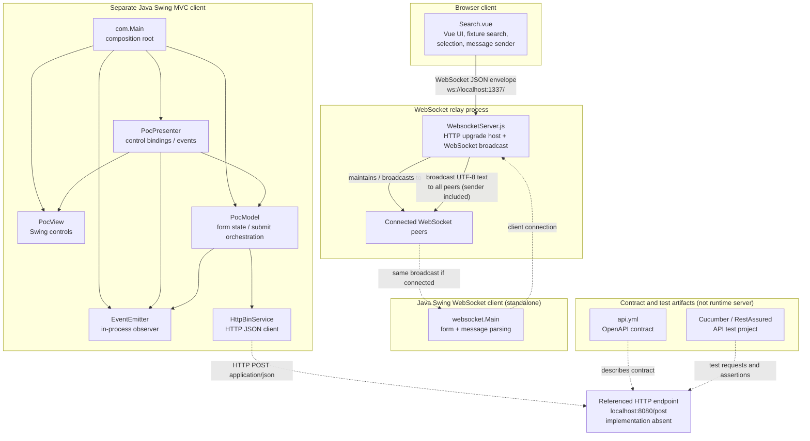
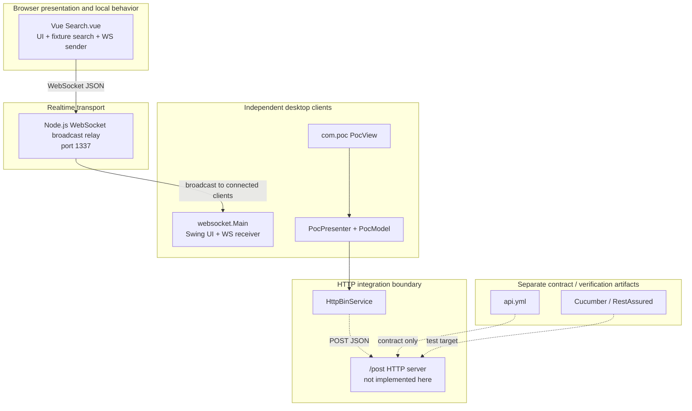

# Architecture Documentation

## Overview

This describes the repository as it exists: a set of small Allegro-oriented person/address/payment prototypes, not a single integrated production application. The source has two independent Java Swing entry points, a Vue browser client, a Node.js WebSocket relay, and a separate API-test/contract artifact. No HR application or locally implemented HTTP API is present.

| Aspect | Observed |
|---|---|
| Architecture style | Prototype collection: loosely coupled WebSocket clients around a relay, plus an independent Swing MVC-style HTTP client and standalone API tests |
| Primary languages | Java, JavaScript, Vue single-file components |
| UI technologies | Java Swing; Vue 2 |
| Messaging | WebSocket; text/UTF-8 JSON envelopes sent to `ws://localhost:1337/` |
| HTTP | `com.poc` client sends JSON `POST http://localhost:8080/post`; server implementation absent |
| Persistence | None shown; Vue records and test data are in-memory/local fixtures |
| External services | Referenced HTTP `/post` endpoint only; not supplied by this repository |

### Architectural interpretation

The main implemented cross-process path is Vue → Node WebSocket relay → connected WebSocket clients, including the standalone `websocket.Main` Swing receiver when connected. Vue search uses fixtures embedded in `Search.vue`. The relay broadcasts incoming UTF-8 messages to every connected client, including the sender; it does not implement search or HTTP form submission.

`com.Main` starts another Swing program. Its `PocView`, `PocPresenter`, `PocModel`, and `HttpBinService` form a separate MVC-style client flow that submits to `/post`. The Node relay is not that endpoint. The Cucumber/RestAssured project and `api.yml` describe/test an API boundary but do not implement it.

## System Context

The diagram shows the expected endpoint boundary, not an endpoint implemented by Node or another server module in this repository. The Vue client also receives its own relay broadcast, but its inbound `onmessage` handler is commented out.

## Component Architecture

The relay-to-client route is shown as an expected runtime connection; the Vue and Java clients independently connect to the fixed local WebSocket URL. The dotted reference to `/post` makes explicit that the server side is outside the implementation present here.

### Components

| Component | Logical area | Responsibility | Dependencies / boundary |
|---|---|---|---|
| `Search.vue` | Browser client | Renders the mock form, searches its in-memory fixtures, selects person/payment data, and sends `target`/`content` JSON over WebSocket. Watches textarea changes and sends them too. | Browser WebSocket API; `ws://localhost:1337/`; no search backend |
| `WebsocketServer.js` | Relay | Hosts a WebSocket server on an HTTP server at port 1337; relays received UTF-8 text to every currently connected client. | Node `http`, npm `websocket`; no domain/API service behavior |
| `websocket.Main` | Standalone Swing client | Builds an independent Swing form, connects with the Java WebSocket API/Tyrus, and routes recognized `textarea`/`textfield` messages into UI fields. | Node relay via WebSocket; JSON-P parsing |
| `com.Main` | Swing application bootstrap | Constructs the `com.poc` view, model, presenter, and event emitter. | `com.poc` classes; independent Java entry point |
| `PocView` | Swing presentation | Builds the form controls and submit button. | Swing/AWT; `PocPresenter` binds behavior |
| `PocPresenter` | Swing presentation coordination | Synchronizes view inputs with model values, invokes model submission, and renders event text/reset behavior. | `PocView`, `PocModel`, `EventEmitter` |
| `PocModel` | Swing application/model | Holds enum-keyed `ValueModel` fields, stringifies the form values, calls the HTTP adapter, and emits response-derived text. | `HttpBinService`, `EventEmitter`; no persistence |
| `EventEmitter` | In-process utility | Synchronously notifies registered listeners. | `EventListener` callback; not a message broker |
| `HttpBinService` | HTTP integration | Sends JSON via HTTP POST to `http://localhost:8080/post` and reads a response. | `HttpURLConnection`, JSON-P; endpoint implementation absent |
| `api.yml` | Contract artifact | Describes an OpenAPI POST `/post` interface. | Does not host or implement the endpoint |
| API test project | Verification only | Cucumber steps and RestAssured client prepare requests and assert responses against a configured target. | Separate test Maven project; not a server implementation |

### Important boundaries

- `websocket.Main` and `com.Main` are distinct Swing applications with different responsibilities and integrations. Their similar form fields do not make them a single application.
- The submit button in `websocket.Main` only prints a click message; it is not connected to `PocModel` or `HttpBinService`.
- The WebSocket JSON envelope uses `target` and `content`; the receiver handles `textarea` and `textfield`. This is an implicit client/relay convention, not a separately defined or validated schema.
- `api.yml` and API-test assertions are evidence of a described/expected API, not of locally implemented endpoint behavior. The Node process only supplies the WebSocket relay.
- There is no database, durable fixture store, or backend search service represented in the analyzed source.

## Logical Layers / Deployment Zones

These are logical responsibility zones, **not** a single layered application with all dependencies flowing through one stack.

## Architectural Patterns

1. **MVC-style presentation coordination (partial)** — `com.Main`, `PocView`, `PocPresenter`, and `PocModel` separate form construction, bindings, and state/submission. This is confined to the `com.poc` Swing app; it is not a repository-wide architecture.
2. **Observer / in-process event dispatch** — `EventEmitter` holds listeners and synchronously emits response text to the presenter. It is local to the `com.poc` flow.
3. **WebSocket relay / broadcast** — `WebsocketServer.js` broadcasts each received UTF-8 frame to the active client list. It does not interpret the payload.
4. **Fixture-driven client behavior** — the Vue component searches a hard-coded local array; there is no repository/search service.
5. **API test client separated from server** — the Cucumber/RestAssured project tests a configured HTTP target, while the repository contains no matching server implementation.

No repository, database, microservice, event-bus, or clean/hexagonal architecture is evidenced. The clients are loosely coupled by WebSocket/HTTP conventions and fixed local addresses, but the source does not show service discovery, a shared deployment configuration, a versioned message schema, or a complete integrated runtime.

## Protocols and External Dependencies

| Boundary | Protocol / address | Direction and data | Implementation status |
|---|---|---|---|
| Vue ↔ Node relay | WebSocket, `ws://localhost:1337/` | Vue sends JSON text (`target`, `content`); relay broadcasts UTF-8 message text to connected clients, including sender | Both client and relay source are present |
| Relay → Swing receiver | WebSocket broadcast | Same text frame; Swing parses JSON and handles recognized target values | Receiver source present; requires both processes running |
| `com.poc` → POST endpoint | HTTP POST, `application/json`, `http://localhost:8080/post` | Java sends string-valued JSON properties | Client present; endpoint implementation absent |
| API test project → API target | HTTP via RestAssured | Requests and response assertions defined by test code | Test client present; target is configured by tests and is not implemented here |
| OpenAPI artifact | `api.yml` | Describes a POST contract | Specification only; not executable server code |

## Recommendations

### Strengths

- The main WebSocket flow has few runtime components and can be understood as browser client → relay → connected receiver.
- The independent Swing MVC-style app has a clear view/presenter/model split and a small HTTP adapter boundary.
- Prior analysis and test artifacts make important implementation gaps visible.

### Areas to clarify before treating this as one system

- Choose and document the intended Swing entry point; current launch configurations target different prototypes.
- If the HTTP form submission is expected to work end to end, provide the `/post` server separately and reconcile its actual request/response contract with `api.yml` and the test payloads.
- Define and validate a shared WebSocket message schema, and document lifecycle/error behavior if the relay is to be used beyond the local PoC.
- Keep fixture-only search and API-test expectations explicitly distinguished from server-backed behavior.
