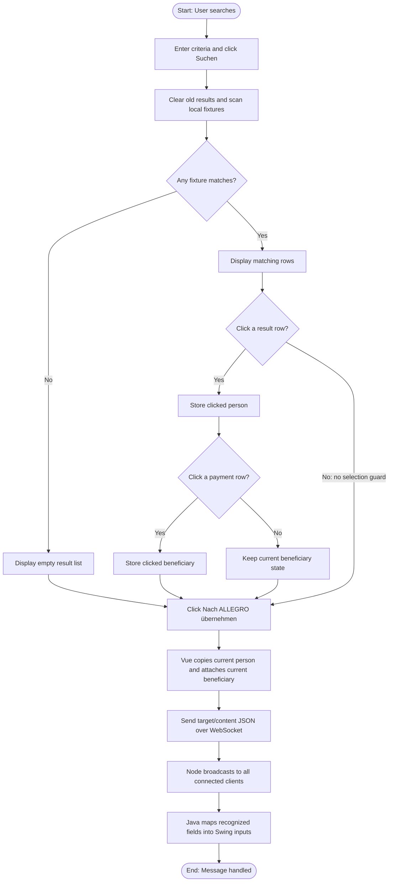
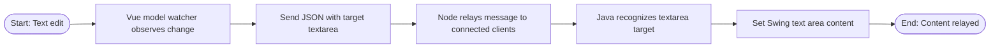
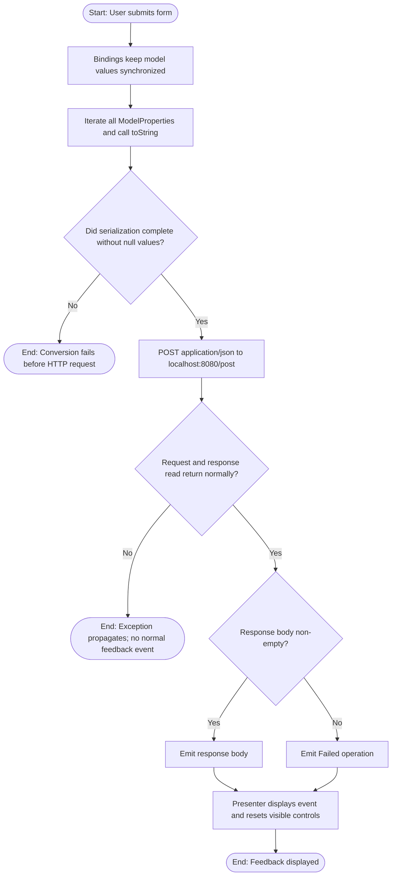

# Business Process Workflows

## Overview

These BPMN-style Mermaid diagrams describe workflows evidenced in this repository's Allegro-oriented Swing/Vue/WebSocket proof of concept and its API test artifacts. They do not describe an HR system.

**Evidence labels matter:** the Vue search and message handoff, textarea relay, and `com.poc` form submission are source-proven client-side flows. The `/post` service behavior asserted by Cucumber is only a test expectation: no implementation of the port-8080 endpoint exists here. `api.yml` is a contract artifact, not a server.

| Process | Description | Trigger | Evidence | Participants |
|---------|-------------|---------|----------|--------------|
| PROC-001 | Search and transfer Allegro person/payment data | User clicks Suchen | Implemented Vue/relay/Java flow | User, Vue client, Node relay, Java Swing receiver |
| PROC-002 | Relay Vue textarea edits to Swing | User edits textarea | Implemented Vue/relay/Java flow | User, Vue client, Node relay, Java Swing receiver |
| PROC-003 | Submit and reset the `com.poc` Swing form | User clicks Anordnen | Client flow implemented; endpoint absent | User, Swing presenter/model, HTTP client, external endpoint |
| PROC-004 | Cucumber POST API contract test | Cucumber scenario runs | Test expectations only for server behavior | Test runner, step definitions, RestAssured client, external endpoint |

## Process diagrams

### PROC-001: Search and transfer Allegro person/payment data

**Description:** Search the Vue component's in-memory sample records, optionally select a person/payment beneficiary, and relay a transfer message to the Java Swing WebSocket receiver.

**Trigger:** User enters criteria and clicks **Suchen**.

**Participants:** Allegro PoC user, Vue Search client, Node WebSocket relay, Java Swing WebSocket receiver.

**Business rules applied:** BR-001, BR-002, BR-003, BR-004.

**Process diagram:**



**Process steps:**

| Step | Name | Performer | Description |
|------|------|-----------|-------------|
| 1 | Search local records | Vue Search client | Clears the result list and searches hard-coded fixtures. Populated criteria are ORed; text comparisons use case-insensitive substring matching, while postal code is exact. |
| 2 | Select a person | User / Vue Search client | Clicking a result sets `selected_result`; no fresh selection is required before transfer. |
| 3 | Select payment beneficiary | User / Vue Search client | Clicking a beneficiary stores that object. No default, validity-date check, or bank-detail validation runs. |
| 4 | Send transfer message | Vue Search client | Deep-copies the current person value and replaces its beneficiary list with the currently selected beneficiary value. |
| 5 | Relay message | Node WebSocket relay | Broadcasts the received UTF-8 message to all connected clients. |
| 6 | Populate form fields | Java Swing receiver | Handles the `textfield` target and maps name, first name, DOB, ZIP, city, street, house number, IBAN, BIC, and valid-from. |

**Source-proven behavior and gaps:** Search is local, not backend-backed. Search does not clear `selected_result`; selecting a different person does not clear the beneficiary selection. The transfer button remains available with no selection guard, so it can send an empty or stale/incomplete selection. The Java mapping handles only a subset of the record.

**Source files:**
- `node-vue-client/src/components/Search.vue`
- `node-server/src/WebsocketServer.js`
- `swing/src/main/java/websocket/Main.java`

### PROC-002: Relay Vue textarea edits to Swing

**Description:** A Vue textarea change triggers a WebSocket message which the Node relay broadcasts and the Java receiver places in its text area.

**Trigger:** User changes the Vue textarea while the socket is available.

**Participants:** Allegro PoC user, Vue Search client, Node WebSocket relay, Java Swing WebSocket receiver.

**Business rules applied:** BR-005.

**Process diagram:**



**Source-proven behavior and gaps:** Each model change is sent; there is no debounce, persistence, offline queue, or business-level send-error feedback.

**Source files:**
- `node-vue-client/src/components/Search.vue`
- `node-server/src/WebsocketServer.js`
- `swing/src/main/java/websocket/Main.java`

### PROC-003: Submit and reset the `com.poc` Swing form

**Description:** The `com.poc` presenter synchronizes UI state with a model, serializes all model properties as strings, and submits JSON to a local endpoint. On a normal response, the model emits body text or `Failed operation`; the presenter displays the event and resets the controls.

**Trigger:** User clicks **Anordnen** in the `com.poc` Swing view.

**Participants:** Allegro PoC user, `PocView`, `PocPresenter`, `PocModel`, `HttpBinService`, external/local POST endpoint (implementation absent from this repository).

**Business rules applied:** BR-006, BR-007, BR-008, BR-009.

**Process diagram:**



**Process steps:**

| Step | Name | Performer | Description |
|------|------|-----------|-------------|
| 1 | Bind controls | `PocPresenter` | Text and radio controls update model values. Gender controls are grouped; female is selected by default. |
| 2 | Serialize model | `PocModel` | Iterates every `ModelProperties` entry and calls `toString()` on its value. A null value can fail before the request. |
| 3 | POST JSON | `HttpBinService` | Sends `application/json` to `http://localhost:8080/post` and reads the response stream. |
| 4 | Select event text | `PocModel` | Emits a non-empty response body or `Failed operation` for an empty body returned normally. HTTP status is not checked as the success criterion. |
| 5 | Display/reset | `PocPresenter` | Writes event text to the text area, clears text controls, and restores female selection. |

**Important boundary:** The client request flow is implemented, but the repository does not implement the `/post` endpoint. `HttpBinService` uses `getInputStream()` and `Scanner.next()`, so HTTP/transport errors or an empty stream may throw before the model's empty-body branch. This description applies to `com.Main`/`com.poc`; the distinct `websocket.Main` form has an **Anordnen** button whose action only prints a message and does not submit.

**Source files:**
- `swing/src/main/java/com/Main.java`
- `swing/src/main/java/com/poc/presentation/PocView.java`
- `swing/src/main/java/com/poc/presentation/PocPresenter.java`
- `swing/src/main/java/com/poc/model/PocModel.java`
- `swing/src/main/java/com/poc/model/HttpBinService.java`
- `swing/src/main/java/com/poc/model/ModelProperties.java`
- `api.yml` (contract artifact only)

### PROC-004: Cucumber POST API contract test — expectation, not server implementation

**Description:** The test suite prepares request data, sends JSON to `/post`, and asserts scenario-specific response properties. This depicts an implemented test-client workflow, not a proven endpoint process.

**Trigger:** A Cucumber scenario runs.

**Participants:** Cucumber runner, `PostStepDefinitions`, `ApiClient` (RestAssured), external endpoint under test (not implemented in this repository).

**Business rules applied:** BR-010.

**Process diagram:**

```mermaid
flowchart TD
    A([Start: Run Cucumber scenario]) --> B[Prepare complete, partial, empty, or fixture-based request map]
    B --> C{Request map empty?}
    C -->|Yes| D[ApiClient sends literal empty object {}]
    C -->|No| E[ApiClient sends populated JSON map]
    D -.-> F[External POST endpoint: implementation absent]
    E -.-> F
    F -.-> G{Response returned?}
    G -.->|Yes| H[Assert expected status, body/fields, or content type]
    G -.->|No| K([End: Scenario fails])
    H --> I{Assertions pass?}
    I -->|Yes| J([End: Scenario passes])
    I -->|No| K
```

**Test expectations (not source-proven endpoint behavior):**
- Scenarios expect HTTP 200 for complete, first/last-name-only, and empty-object POST requests.
- Other scenarios assert response values or JSON content type.
- The `previously submitted` step loads a local fixture into the current request map; it does not make an earlier network request and does not demonstrate persistence.
- Submitted-data matching uses value substring checks in at least one assertion.
- The API test project has no server implementation. `api.yml` is an artifact, and its request schema uses a nested `user` property, while the test client and Swing client submit top-level field maps. The repository does not establish that these are one working endpoint contract.

**Source files:**
- `analysis_output/api-test-generator/src/test/resources/features/java_update.feature`
- `analysis_output/api-test-generator/src/test/java/com/poc/api/steps/PostStepDefinitions.java`
- `analysis_output/api-test-generator/src/test/java/com/poc/api/support/ApiClient.java`
- `analysis_output/api-test-generator/src/test/java/com/poc/api/support/TestContext.java`
- `analysis_output/api-test-generator/src/test/java/com/poc/api/support/TestDataBuilder.java`
- `api.yml`

## Scope and interpretation

- These diagrams describe the Allegro-oriented person/address/payment prototype and associated form submission/testing artifacts, not HR processes.
- No database/persistence process is shown: the Vue records and test “previous submission” data are local fixtures.
- The WebSocket relay is a broadcast mechanism, not an Allegro backend.
- The API test flow is explicitly classified as external behavior expected by tests; assertions must not be read as evidence that an endpoint is present or returns those results.
- A separate `websocket.Main` UI does receive WebSocket messages, but its submit button handler is a console-print stub. It is not conflated with the implemented `com.poc` HTTP submission flow.
