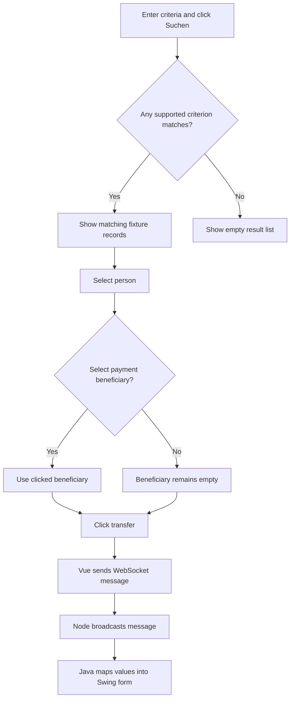
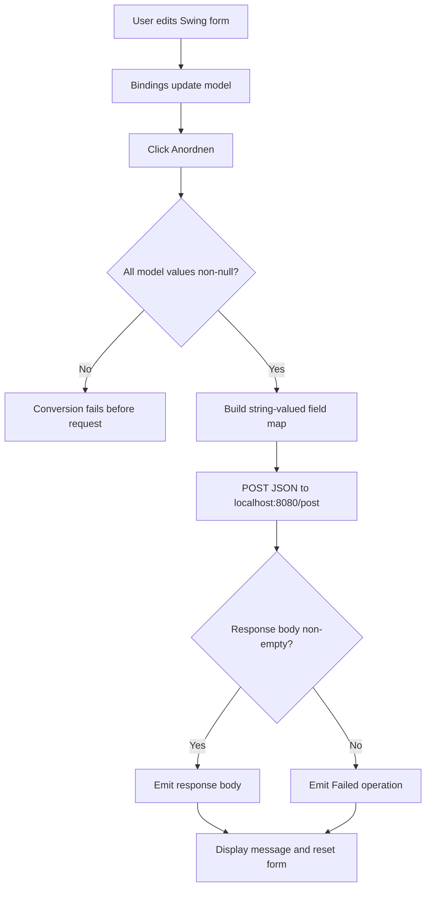

# Business Rules Documentation

## Executive Summary

The source implements an **Allegro-oriented proof of concept**, not an HR application. The Vue client searches a small, hard-coded set of people and payment beneficiaries; a Node WebSocket relay broadcasts selected data to a Java Swing form. A separate Swing model/presenter prototype posts its fields to a local `/post` endpoint.

Ten rules are documented: four decision, four process, and two validation/UI-precondition rules. There are no business calculations, authorization rules, or implemented temporal rules. In particular, payment `valid_from` values are displayed and transferred but not evaluated. Business-field validation is largely absent.

The Cucumber/RestAssured project describes expected API behavior, including HTTP 200 for partial and empty JSON-object requests. These are **test assertions against an endpoint**, not proof of server behavior: this repository contains no implementation of the port-8080 POST endpoint. The API tests also do not demonstrate persistence.

## Business Domains

- Search & Payment Selection
- Allegro Form Handoff
- Payment Details
- Allegro Form Data
- Allegro Form Submission
- API Test Contract

## Rules by Domain

### Search & Payment Selection

#### BR-001: Search criteria use OR matching
- **Type:** Decision
- **Priority:** Medium
- **Description:** A record is returned if any populated supported criterion matches: last name, first name, postal code, city, street, or house number. Search is performed over the Vue component's in-memory fixtures.
- **Conditions:** User clicks **Suchen**.
- **Actions:** Matching records are added to the displayed result list.
- **Exceptions/gaps:** Empty criteria match nothing. Search is not backed by a service and only sees hard-coded sample data.
- **Implementation:** `Search.searchPerson()` in `node-vue-client/src/components/Search.vue`.
- **Example:**
  ```js
  if (this.formdata.last && /* match */ ||
      this.formdata.first && /* match */ ||
      this.formdata.zip && /* match */) {
    this.search_result.push(element);
  }
  ```

#### BR-002: Text search is case-insensitive substring; postal code is exact
- **Type:** Decision
- **Priority:** Medium
- **Description:** Name, first name, city, street, and house number use case-insensitive substring matching. Postal code uses equality.
- **Conditions:** The corresponding criterion is populated.
- **Actions:** The record matches when the selected criterion's comparison succeeds.
- **Exceptions/gaps:** No trimming, accent normalization, ZIP-prefix search, or date-of-birth search is implemented.
- **Implementation:** `Search.searchPerson()` in `node-vue-client/src/components/Search.vue`.
- **Example:**
  ```js
  element.name.toLowerCase().indexOf(this.formdata.last.toLowerCase()) >= 0
  element.zip == this.formdata.zip
  ```

### Allegro Form Handoff

#### BR-003: Transfer the selected person and payment record
- **Type:** Process
- **Priority:** High
- **Description:** The transfer button deep-copies `selected_result`, replaces its payment-beneficiary list with the currently selected beneficiary, and sends it as a `textfield` message. The Node relay broadcasts messages; Java parses recognized fields into the Swing form.
- **Conditions:** User clicks **Nach ALLEGRO übernehmen**.
- **Actions:** JSON is sent via WebSocket and mapped values are placed into the Java form.
- **Exceptions/gaps:** No selection guard exists. The code can send an empty person or an empty payment selection. Java only maps name, first name, date of birth, postal code, city, street, house number, IBAN, BIC, and valid-from.
- **Implementation:** `Search.sendMessage()`, `Search.zahlungsempfaengerSelected()` in `node-vue-client/src/components/Search.vue`; relay in `node-server/src/WebsocketServer.js`; `WebsocketClientEndpoint.onMessage()` and `toSearchResult()` in `swing/src/main/java/websocket/Main.java`.
- **Example:**
  ```js
  obj_to_send.zahlungsempfaenger = this.zahlungsempfaenger_selected;
  this.socket.send(JSON.stringify({ target: target, content: obj_to_send }));
  ```

#### BR-005: Textarea edits are sent immediately
- **Type:** Process
- **Priority:** Medium
- **Description:** Every change to the Vue textarea model sends a `textarea`-target message. The relay broadcasts it and the Java client writes the content into its text area.
- **Conditions:** The Vue textarea changes while its WebSocket is available.
- **Actions:** The current text is serialized and broadcast.
- **Exceptions/gaps:** There is no debounce, persistence, offline queue, or business-level send-error feedback.
- **Implementation:** `watch.internal_content_textarea`, `sendMessage()`, and the Java message handler.
- **Example:**
  ```js
  internal_content_textarea: function(val) {
    this.sendMessage(val, "textarea");
  }
  ```

### Payment Details

#### BR-004: Payment beneficiary selection is explicit; validity dates are not evaluated
- **Type:** Decision
- **Priority:** High
- **Description:** Clicking a beneficiary row chooses the record to transfer. `valid_from` and `valid_until` are data displayed in the UI, not filters or eligibility checks.
- **Conditions:** A person has beneficiary rows; user clicks a row to select one.
- **Actions:** The clicked object is assigned to the selected-beneficiary state and used in the transfer payload.
- **Exceptions/gaps:** No default-first choice, required-selection check, effective-date evaluation, or bank-detail validation exists.
- **Implementation:** `Search.zahlungsempfaengerSelected()` and `Search.sendMessage()` in `node-vue-client/src/components/Search.vue`.
- **Example:**
  ```js
  zahlungsempfaengerSelected(zahlungsempfaenger) {
    this.zahlungsempfaenger_selected = zahlungsempfaenger;
  }
  ```

### Allegro Form Data

#### BR-006: Gender controls are mutually exclusive and default to female
- **Type:** Validation (UI constraint/default)
- **Priority:** Medium
- **Description:** The Swing UI puts female, male, and diverse radio buttons in one group. Female is selected initially; after a submission event the presenter clears the other choices and selects female.
- **Conditions:** The Swing form initializes or its presenter handles a response event.
- **Actions:** Selected UI state is bound to the three gender flags; reset restores the female selection.
- **Exceptions/gaps:** This is not server-side validation. The request model carries three separate string-valued flags and no endpoint enforcement is included.
- **Implementation:** `PocView.initUI()`, `PocPresenter` bindings/event listener, and `websocket.Main.initUI()`.
- **Example:**
  ```java
  gender.add(female);
  gender.add(male);
  gender.add(diverse);
  female.setSelected(true);
  ```

### Allegro Form Submission

#### BR-007: Submission requires every model value to be non-null
- **Type:** Validation (implicit precondition)
- **Priority:** High
- **Description:** Before sending, the model iterates every `ModelProperties` entry and calls `toString()` on its value. Any null value fails before the HTTP request. This is a technical completeness precondition rather than intentional required-field validation.
- **Conditions:** User invokes the form action.
- **Actions:** Every model value is converted into a string map entry.
- **Exceptions/gaps:** Presenter bindings initialize the visible text and radio values, but there are no user-facing required-field messages and conversion is not null-safe.
- **Implementation:** `PocModel.action()` and `PocPresenter.initializeBindings()` / `bind()`.
- **Example:**
  ```java
  data.put(val.toString(), model.get(val).getField().toString());
  ```

#### BR-008: Non-empty response body is treated as success
- **Type:** Decision
- **Priority:** Medium
- **Description:** A normally returned, non-empty response body is emitted to the presenter; an empty body yields `Failed operation`. The presenter displays the event and resets visible controls.
- **Conditions:** The POST method returns and a response body is read.
- **Actions:** The response body or failure literal is displayed; inputs are cleared and female is selected.
- **Exceptions/gaps:** Response status is not checked by the model. `HttpBinService` reads `getInputStream()`, so transport or HTTP errors can throw before either event is emitted.
- **Implementation:** `PocModel.action()`, `HttpBinService.post()`, and `PocPresenter` event subscription.
- **Example:**
  ```java
  if (!responseBody.isEmpty()) eventEmitter.emit(responseBody);
  else eventEmitter.emit("Failed operation");
  ```

#### BR-009: Form fields are posted as JSON to `/post`
- **Type:** Process
- **Priority:** Medium
- **Description:** The Swing PoC posts its model map as JSON to `http://localhost:8080/post` with `Content-Type: application/json`. The keys cover personal, address, bank, gender, and textarea fields. The OpenAPI artifact marks the request body required but does not mark individual properties required.
- **Conditions:** The model successfully builds the map.
- **Actions:** JSON is sent by HTTP POST.
- **Exceptions/gaps:** No implementation of the port-8080 endpoint is present. `api.yml` is a contract artifact and does not establish server behavior.
- **Implementation:** `HttpBinService.post()`, `ModelProperties`, and `api.yml`.
- **Example:**
  ```java
  connection.setRequestMethod("POST");
  connection.setRequestProperty("Content-Type", CONTENT_TYPE);
  ```

### API Test Contract

#### BR-010: Tests expect successful echo-style POSTs, including partial and empty objects
- **Type:** Process (test expectation, not server rule)
- **Priority:** Low
- **Description:** Cucumber scenarios expect HTTP 200 for complete, first/last-name-only, and empty JSON-object requests; selected scenarios also expect submitted values or JSON content type in the response.
- **Conditions:** The API tests send a POST to `/post`.
- **Actions:** Step definitions assert status, content type, or response values.
- **Exceptions/gaps:** No API server is implemented in the test project or elsewhere in the inspected repository. The “previously submitted” step loads a fixture map in that scenario; it does not demonstrate persistence. The submitted-data assertion checks for values as substrings in the response.
- **Implementation:** `java_update.feature`, `PostStepDefinitions`, `ApiClient`, and `api.yml` under the paths listed above.
- **Example:**
  ```java
  if (context.getRequestBody().isEmpty()) response = apiClient.postEmpty(path);
  else response = apiClient.post(path, context.getRequestBody());
  ```

## Business Workflows

### WF-001: Search and transfer an Allegro person/payment record

Search is local to Vue fixtures; selection and transfer are client-driven, with the WebSocket relay broadcasting to Java.



**Business rules applied:** BR-001, BR-002, BR-003, BR-004.

**Notable gap:** No guard requires a person or payment selection before transfer; dates do not gate beneficiary eligibility.

### WF-002: Submit and reset the Swing Allegro form



**Business rules applied:** BR-006, BR-007, BR-008, BR-009.

**Notable gap:** The repository has no POST endpoint implementation; a thrown request error is not translated into the model's normal response event.

## Rule Dependencies

- BR-001 and BR-002 determine which local records are available for selection in WF-001.
- BR-004 supplies the optional payment object consumed by BR-003; no rule validates beneficiary selection or validity dates.
- BR-003 depends on the Vue-to-relay-to-Java message path. That path maps only a subset of the Vue record fields.
- BR-006 binds gender UI state into the model and participates in the reset triggered by BR-008.
- BR-007 is a precondition for BR-009: null values prevent the JSON POST from being constructed.
- BR-008 depends on a normal return from BR-009 but does not judge HTTP status.
- BR-010 records expected behavior of a separate test target; it does not implement or guarantee BR-009 endpoint behavior.

## Recommendations

1. Confirm the intended search contract (OR vs AND, normalization, supported fields) and add focused tests for empty criteria and exact/prefix postal matching.
2. Require an explicit person and payment-beneficiary selection before transfer, and define whether the selected beneficiary must be active on the transfer date.
3. Add server-side validation for required fields, gender representation, date formats, IBAN/BIC, and postal codes; present validation errors without relying on null dereferences.
4. Define HTTP success by status code and handle error bodies explicitly instead of treating any non-empty response as success.
5. Clarify which system supplies `/post`, implement it or point tests to the actual endpoint, and avoid describing fixture-loaded “previously submitted” data as persistence.
6. Document whether transferring a person should map additional Vue fields (for example, customer number, nationality, and payment details) that are currently not populated in the Java form.
