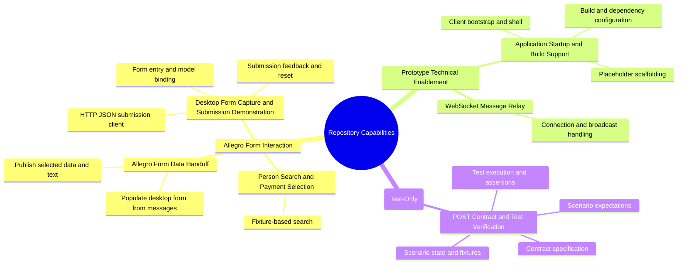
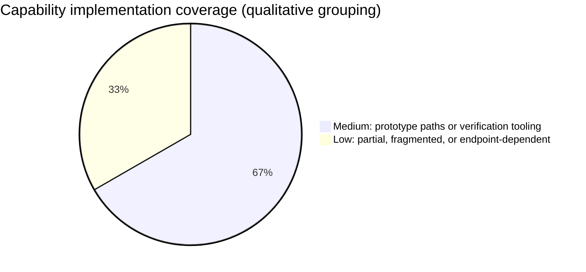
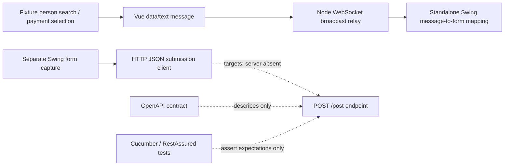

# Business and Technical Capability Mapping

## Overview

This mapping describes the repository as it exists: a small Allegro-oriented form/search and WebSocket proof of concept. It does **not** evidence an HR application, a production search service, a persistent data store, or one integrated production system.

The repository contains three different kinds of evidence:

1. **Implemented prototype behavior:** Vue fixture search/selection, a Node WebSocket broadcast relay, standalone Swing clients, and a Swing form submission client.
2. **Technical enablement:** app bootstrap, field models, transport and build setup.
3. **Contract/test expectations:** an OpenAPI description and Cucumber/RestAssured tests for a `/post` endpoint that is not implemented in this repository.

The capability statuses below distinguish code that runs a local prototype from capability completeness. Mapping confidence means confidence that the file supports the stated capability; it does not mean that the capability is production-ready.

## Scope and evidence

The analysis uses `.geninsights/analysis/analysis_results.json`, `business_rules.json`, `architecture_analysis.json`, and `bpmn_workflows.json`.

- Vue searches a hard-coded in-memory list with OR matching. Some text fields use case-insensitive substring matching; postal code is exact.
- Vue sends selected data or textarea content over WebSocket to a Node relay on port 1337. The relay broadcasts UTF-8 frames and does not interpret their business payload.
- A separate `websocket.Main` Swing client maps recognized messages to its form. It is distinct from the other Swing entry point.
- The separate `com.Main`/`com.poc` Swing form client serializes fields and POSTs to `localhost:8080/post`. The POST server is absent.
- The API test suite's successful, partial, empty, echo/update, and content-type outcomes are **test expectations**, not implemented endpoint behavior. Test fixture setup does not establish persistence.

## Capability map

## Capability hierarchy and coverage

| Domain | Capability | Decomposition | Implementation evidence | Coverage |
|---|---|---|---|---|
| Allegro Form Interaction | Person Search and Payment Selection | Fixture-based person search and selection | Vue component searches its own sample records and captures person/payment selection. | **Medium** — implemented mock only |
| Allegro Form Interaction | Allegro Form Data Handoff | Publish data/text; populate desktop form | Vue sender, WebSocket relay, and separate Swing receiver establish a prototype path. | **Medium** — limited mapping and no delivery guarantees |
| Allegro Form Interaction | Desktop Form Capture and Submission Demonstration | Form/model binding; HTTP JSON client; feedback/reset | Separate Swing form and model can construct a request and handle a normal response event. | **Low overall** — endpoint absent and request/validation gaps |
| Prototype Technical Enablement | WebSocket Message Relay | Connection and broadcast handling | Node process accepts peers and broadcasts text frames. | **Medium** — narrow local relay, no schema/security/recovery behavior |
| Prototype Technical Enablement | Application Startup and Build Support | Bootstrap/shell; build config; placeholder | Entry points and project configuration support the distinct prototype apps. | **Low** — fragmented setup; not an integrated deployment |
| API Contract Verification (Test-Only) | POST API Contract and Test Verification | Contract; test scenarios; runner/client/assertions; scenario fixtures | API specification and executable tests target a separately configured endpoint. | **Medium for test harness; no runtime API capability evidenced** |

Coverage describes how much of the named capability is evidenced in this repository, not a quantitative quality score. For example, a mapped HTTP client is concrete implementation evidence, but the absent server makes the end-to-end form-submission capability low.

## Detailed mappings

### Allegro Form Interaction

#### Person Search and Payment Selection — medium, prototype-limited

**What is implemented:** `Search.vue` searches its embedded records, displays matching people, and supports selection of a person and payment beneficiary. Search criteria use OR semantics; name/address text comparisons are case-insensitive substrings and postal code comparison is exact.

**Boundary:** This is not a backend search, authoritative customer directory, durable record store, or validated payment-eligibility process. No selected-person or beneficiary guard is enforced before transfer, and effective dates/bank details are not validated.

| File | Rationale | Mapping confidence |
|---|---|---|
| `node-vue-client/src/components/Search.vue` | Implements local search, selection state, and initiation of outbound handoff. | High |

#### Allegro Form Data Handoff — medium, prototype path

**What is implemented:** Vue sends `target`/`content` JSON messages for selected form data and textarea edits. The relay broadcasts received UTF-8 frames to connected clients; the standalone Swing WebSocket client parses recognized targets and writes mapped values into its controls.

**Boundary:** No schema validation, durable delivery, offline queue, reconnect policy, or business-level send-failure handling is shown. The Swing receiver maps only a subset of the Vue record. The other Swing form's “Anordnen” button is not this transfer path and is a separate application.

| File | Rationale | Mapping confidence |
|---|---|---|
| `node-vue-client/src/components/Search.vue` | Produces the selected-data and textarea messages. | High |
| `swing/src/main/java/websocket/Main.java` | Receives WebSocket messages and maps recognized values into a desktop form. | High |
| `node-server/src/WebsocketServer.js` | Broadcasts the messages as technical transport; no business interpretation. | High; primary technical mapping is CAP-004 |

#### Desktop Form Capture and Submission Demonstration — low end-to-end coverage

**What is implemented:** The separate `com.poc` Swing view and presenter bind controls to model state. The model converts properties to strings and the HTTP adapter sends JSON to `localhost:8080/post`. Response-derived event text is displayed and the presenter resets visible fields after a normal response event.

**Boundary:** This repository does not implement the port-8080 endpoint. Null model values may fail during conversion; business-field validation is absent; status codes are not the model's success criterion. This is a form/client demonstration, not evidence of a functioning end-to-end business submission service.

| File | Rationale | Mapping confidence |
|---|---|---|
| `swing/src/main/java/com/poc/presentation/PocView.java` | Renders form controls for personal, address, payment, gender, and text data. | High |
| `swing/src/main/java/com/poc/presentation/PocPresenter.java` | Binds controls, invokes submission, and handles response/reset behavior. | High |
| `swing/src/main/java/com/poc/model/ModelProperties.java` | Catalogs the form properties represented in model state and submission. | Medium |
| `swing/src/main/java/com/poc/ValueModel.java` | Generic state holder used by presenter/model bindings. | Medium |
| `swing/src/main/java/com/poc/model/PocModel.java` | Orchestrates field serialization, HTTP submission, and response-derived event. | High |
| `swing/src/main/java/com/poc/model/HttpBinService.java` | Sends JSON POST to the external-to-this-repository `/post` endpoint. | High |
| `swing/src/main/java/com/poc/model/EventEmitter.java` | Relays response text to local listeners synchronously. | Medium |
| `swing/src/main/java/com/poc/model/EventListener.java` | Defines the local response callback contract. | Medium |

### Prototype Technical Enablement

#### WebSocket Message Relay — medium, narrow transport

The relay is a technical enabler for the handoff, not a search, customer, or payment service. It broadcasts incoming UTF-8 messages to connected peers, including the sender; no payload semantics, persistence, or business validation are implemented.

| File | Rationale | Mapping confidence |
|---|---|---|
| `node-server/src/WebsocketServer.js` | Implements connection tracking and broadcast. | High |
| `node-server/package.json` | Declares the WebSocket runtime dependency. | Low |

#### Application Startup and Build Support — low, fragmented prototypes

These files support application startup, rendering, or build setup. They do not constitute business functionality or prove a unified deployment. `ViewData` is empty and is mapped only to make the analyzed file's lack of behavior explicit.

| File | Rationale | Mapping confidence |
|---|---|---|
| `swing/src/main/java/com/Main.java` | Wires the separate `com.poc` Swing prototype. | Low |
| `node-vue-client/src/main.js` | Bootstraps the Vue browser application. | Medium |
| `node-vue-client/src/App.vue` | Renders the client shell and Search component. | Medium |
| `pom.xml` | Configures Java compilation and root dependencies. | Low |
| `node-vue-client/package.json` | Declares Vue client dependencies and scripts. | Low |
| `node-vue-client/babel.config.js` | Configures frontend transpilation. | Low |
| `swing/src/main/java/com/poc/model/ViewData.java` | Empty placeholder; no capability behavior is implemented. | Low |

### API Contract Verification (Test-Only)

**Implemented here:** a specification and test client/tooling that can express requests and assert responses against a configured API target.

**Not implemented here:** the HTTP server itself. The feature's HTTP 200, echo/update, partial/empty request, and content-type expectations must not be presented as delivered product capabilities. The "previously submitted" scenario loads local fixture data; it does not prove persistence.

| File | Rationale | Mapping confidence |
|---|---|---|
| `api.yml` | Describes the POST `/post` request/response contract only. | High |
| `analysis_output/api-test-generator/src/test/resources/features/java_update.feature` | Declares API test expectations, not endpoint implementation. | High |
| `analysis_output/api-test-generator/src/test/java/com/poc/api/runner/CucumberTestRunner.java` | Configures test discovery and execution. | Medium |
| `analysis_output/api-test-generator/src/test/java/com/poc/api/steps/PostStepDefinitions.java` | Prepares requests and asserts configured endpoint responses. | High |
| `analysis_output/api-test-generator/src/test/java/com/poc/api/support/ApiClient.java` | Sends test HTTP requests using RestAssured. | High |
| `analysis_output/api-test-generator/src/test/java/com/poc/api/support/TestContext.java` | Stores per-scenario URL, request, and response state. | Medium |
| `analysis_output/api-test-generator/src/test/java/com/poc/api/support/TestDataBuilder.java` | Creates test fixture maps, not persistent application records. | Medium |
| `analysis_output/api-test-generator/src/test/resources/cucumber.properties` | Configures Cucumber feature, glue, reporting, and filters. | Medium |
| `analysis_output/api-test-generator/pom.xml` | Configures isolated test-project dependencies/build. | Low |

## Coverage and gaps

The two low-rated areas are the end-to-end desktop submission capability (HTTP server absent) and unified application startup/build support (several separate prototypes/configurations). The four medium areas describe bounded mock/transport/test implementations and are not production maturity ratings.

### Implemented versus expected

| Area | Evidence status |
|---|---|
| Vue fixture search and selection | Implemented locally in the browser component |
| WebSocket broadcast and Swing message mapping | Implemented in separate relay/client components; local prototype path |
| Swing form field binding and outbound HTTP client | Implemented as a client-side demonstration |
| HTTP `/post` service behavior | Not implemented in repository |
| Echo/update, empty/partial POST success, response media type | Test/specification expectations only |
| Durable customer/payment storage or prior-submission persistence | No evidence |
| HR capabilities | No evidence |

## Capability dependencies

The search/handoff path and the Swing HTTP-client path are separate implementations. The relay on port 1337 does not supply the HTTP endpoint on port 8080.

## Recommendations

1. Keep descriptions and product claims scoped to an Allegro-oriented prototype; do not infer HR, customer-master, payment execution, or durable-record capabilities.
2. If search is intended to become a business capability, replace fixtures with an explicit service/data boundary and define matching, empty-query, and selection rules.
3. If end-to-end form submission is expected, identify or implement the `/post` server and reconcile its behavior with `api.yml` and the tests.
4. Define and validate a WebSocket message schema, required selection behavior, and delivery/error handling before relying on the handoff beyond local experimentation.
5. Treat API test outcomes as expectations until they pass against a known endpoint; do not infer persistence from fixture-loaded “previously submitted” scenarios.
