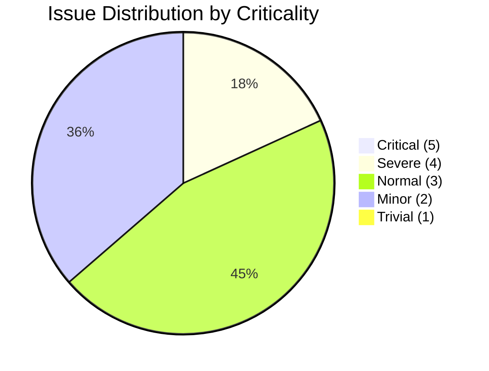
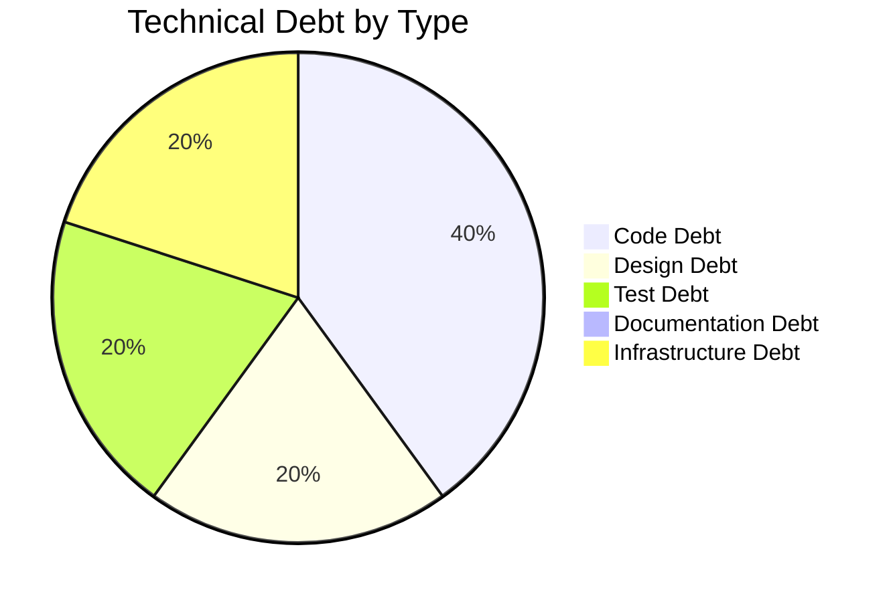

# Code Assessment Report

## Executive Summary

**Overall Health Score:** 65/100

The repository is a small Allegro-oriented form/search proof of concept, not an HR application. It contains distinct Swing prototypes, a Vue mock with local sample search, a Node WebSocket relay, an OpenAPI artifact, and a separate API test project. Findings below are verified against the source and should be interpreted in that prototype context; the API tests describe an external endpoint and do not establish that this repository implements it.

| Metric | Value |
|--------|-------|
| Files Reviewed | 28 |
| Total Issues | 11 |
| Critical Issues (criticality 5) | 0 |
| Technical Debt Items | 5 |
| Enhancement Suggestions | 4 |
| Average Code Complexity | 2.86/10 |
| Average Logic Complexity | 1.50/10 |

Highest priority is to align the API contract and tests, and to prevent the WebSocket relay from exposing one client's person/payment-like messages to every connected client if it is used beyond a private local demo. Swing network calls also need to stop blocking the UI thread.

## Health Score Breakdown

The score follows the configured deductions: 2 severe issues (-10), 5 normal issues (-10), 4 minor issues (-4), 1 high-impact debt (-5), and 3 medium-impact debt items (-6). There are no criticality-5 issues and no files scored above complexity 7. **Result: 65/100.**



## Critical Issues (Must Fix)

No criticality-5 issues were identified. The following severe issues should be prioritized:

### ISS-004: Unrestricted WebSocket relay broadcasts every message
- **File:** `node-server/src/WebsocketServer.js` (Line 27)
- **Type:** Security — Criticality 4 (Severe)
- **Description:** The server accepts origins without an allowlist and broadcasts received messages to all connected clients. The payloads include person and payment details, so this is unsuitable for a shared or production deployment.
- **Solution:** Enforce an origin allowlist and client authentication for any non-local use. Validate the envelope and payload size, route only to the intended client/session rather than broadcasting, and avoid logging full data payloads. Add tests for rejected origins and isolation between clients.
- **Estimated Time:** 5 hours

### ISS-007: OpenAPI and test payload shapes disagree
- **File:** `api.yml` (Line 91)
- **Type:** Maintainability — Criticality 4 (Severe)
- **Description:** OpenAPI describes a top-level `user` object, but Cucumber requests are flat maps; response nesting also conflicts with test assertions. The contract being demonstrated is therefore ambiguous.
- **Solution:** Choose one JSON wire format and align the OpenAPI schemas, Swing serializer, and fixtures/assertions to it. Document required fields and examples, then add contract validation so mismatches fail automatically.
- **Estimated Time:** 4 hours

## Other Issues

### ISS-001: Nullable model values can break submission
- **File:** `swing/src/main/java/com/poc/model/PocModel.java` (Line 39) · **Criticality:** 2
- **Description:** The model starts values as null and calls `toString()` on each. Submitting before all values have been initialized throws `NullPointerException`.
- **Solution:** Use deliberate defaults, restrict direct mutation of the model map, validate required fields, and add tests for newly constructed and partially populated models.
- **Estimated Time:** 1.5 hours

### ISS-002: HTTP response and connection lifecycle are fragile
- **File:** `swing/src/main/java/com/poc/model/HttpBinService.java` (Line 16) · **Criticality:** 3
- **Description:** The request has no timeouts, reads only the success stream, and does not reliably close/disconnect resources on failures.
- **Solution:** Set connect/read timeouts, use try-with-resources, inspect the error stream for non-2xx responses, return status with the body, and guarantee cleanup. Test failure and timeout behavior using a local server.
- **Estimated Time:** 3 hours

### ISS-003: Synchronous HTTP work blocks Swing's Event Dispatch Thread
- **File:** `swing/src/main/java/com/poc/presentation/PocPresenter.java` (Line 40) · **Criticality:** 3
- **Description:** The button listener performs network I/O synchronously, freezing the form if the endpoint is slow. Exceptions are rethrown instead of shown as a result.
- **Solution:** Run submission in a `SwingWorker` or bounded executor, keep UI changes on the EDT, show pending/success/failure states, and test with a delayed local endpoint.
- **Estimated Time:** 3 hours

### ISS-005: WebSocket callbacks update Swing components off the EDT
- **File:** `swing/src/main/java/websocket/Main.java` (Line 286) · **Criticality:** 3
- **Description:** The callback thread writes directly to Swing controls, which are not generally thread-safe.
- **Solution:** Parse/validate off-thread and dispatch component updates with `SwingUtilities.invokeLater`. Test the mapping separately and handle malformed messages without partial view updates.
- **Estimated Time:** 2 hours

### ISS-006: Vue WebSocket lifecycle and send failures are unhandled
- **File:** `node-vue-client/src/components/Search.vue` (Line 131) · **Criticality:** 3
- **Description:** Only `onopen` is handled; there is no error/close feedback or `readyState` guard on sends, and `disconnect()` assumes a socket exists.
- **Solution:** Track connection state, handle open/error/close, guard sends, make disconnect idempotent, and close the socket on component destruction. Avoid sending stale queued data after reconnect.
- **Estimated Time:** 2.5 hours

### ISS-008: “Empty request body” test sends an empty JSON object
- **File:** `analysis_output/api-test-generator/src/test/java/com/poc/api/support/ApiClient.java` (Line 54) · **Criticality:** 2
- **Description:** `postEmpty` sends `"{}"`, not a zero-byte body, so the scenario does not test what its name claims.
- **Solution:** Decide which behavior is intended and either omit the body or rename the test to explicitly cover an empty JSON object. Add distinct cases only if both matter.
- **Estimated Time:** 1 hour

### ISS-009: Fixture setup is described as prior persistence
- **File:** `analysis_output/api-test-generator/src/test/java/com/poc/api/steps/PostStepDefinitions.java` (Line 65) · **Criticality:** 3
- **Description:** The “previously submitted” step loads a map fixture but performs no prior request or persistence check.
- **Solution:** Rename the step to indicate fixture setup, or implement a real create-then-update workflow against a provisioned service and verify persisted state through a read operation.
- **Estimated Time:** 2 hours

### ISS-010: Response-field assertion can pass on a value in the wrong place
- **File:** `analysis_output/api-test-generator/src/test/java/com/poc/api/steps/PostStepDefinitions.java` (Line 131) · **Criticality:** 2
- **Description:** A missing JSON path falls back to searching the entire body for the expected string, weakening field-equality assertions.
- **Solution:** Assert the exact path defined by the agreed response schema and fail clearly when the path is absent. Add a negative case where the value appears under another field.
- **Estimated Time:** 1.5 hours

### ISS-011: Handoff is enabled without selecting a result
- **File:** `node-vue-client/src/components/Search.vue` (Line 81) · **Criticality:** 2
- **Description:** The button sends an empty or incomplete object when no person/payment result is selected.
- **Solution:** Define required selection state, disable the button until satisfied, validate again in the send method, and present an explanatory message. Test incomplete and complete selections.
- **Estimated Time:** 1.5 hours

## Technical Debt Overview

### By Category



### High Impact Items

#### TD-001: Unclear canonical application path
- **File:** `swing/src/main/java/websocket/Main.java`
- **Impact:** HIGH · **Priority:** 5
- **Description:** Two independent Swing entry points overlap conceptually with the Vue mock, relay, and API artifact; no single integrated path is established.
- **Suggested Fix:** Select and document the canonical prototype flow, consolidate or label alternatives, and add a smoke test for the intended launch path.
- **Estimated Fix Time:** 8 hours

### Medium Impact Items

#### TD-002: UI, transport, parsing, and state combined in one Swing class
- **File:** `swing/src/main/java/websocket/Main.java`
- **Impact:** MEDIUM · **Priority:** 3
- **Suggested Fix:** Extract a typed parser/message model and WebSocket service; keep Swing rendering in a view/controller layer and add parser tests.
- **Estimated Fix Time:** 6 hours

#### TD-003: No automated tests for the desktop application code
- **File:** `swing/src/main/java/com/poc/model/PocModel.java`
- **Impact:** MEDIUM · **Priority:** 4
- **Suggested Fix:** Add model/serialization, message-parser, and HTTP success/failure tests. The Cucumber suite targets an external endpoint and is not a substitute for application tests.
- **Estimated Fix Time:** 8 hours

#### TD-004: Separate Java targets and build/test lifecycles
- **File:** `pom.xml`
- **Impact:** MEDIUM · **Priority:** 3
- **Suggested Fix:** Document supported JDKs and commands or create an aggregator if the projects are intended to build together; pin compiler configuration and run relevant checks in CI.
- **Estimated Fix Time:** 5 hours

#### TD-005: Unused empty placeholder
- **File:** `swing/src/main/java/com/poc/model/ViewData.java`
- **Impact:** LOW · **Priority:** 1
- **Suggested Fix:** Remove it if obsolete, or give it a defined purpose and actual usage.
- **Estimated Fix Time:** 0.5 hours

## Recommended Enhancements

### Priority 5 — ENH-001: Establish one executable JSON contract
Align OpenAPI, Swing serialization, and Cucumber payloads; include required values and examples and enforce the schema in tests. This reduces integration ambiguity and wire-format drift.

```yaml
PostRequest:
  type: object
  required: [user]
  properties:
    user:
      $ref: '#/components/schemas/AllegroForm'
```

### Priority 4 — ENH-002: Define WebSocket connection and message policy
Configure origin checks, payload validation, routing, logging, and shutdown explicitly. Keep permissive local-demo behavior isolated from shared use.

### Priority 4 — ENH-003: Separate asynchronous submission from Swing presentation
Return a typed result from the transport layer and run requests off the EDT; render pending, success, and failure states on the EDT. This improves responsiveness and testability.

### Priority 3 — ENH-004: Make API scenarios deterministic and structurally assertive
Configure the external API base URL outside feature text, distinguish no body from `{}`, assert exact response paths, and rename fixture-only steps so they do not imply persistence.

## Files by Complexity

| File | Code | Logic | Issues |
|------|------|-------|--------|
| `swing/src/main/java/com/Main.java` | 2 | 2 | 0 |
| `swing/src/main/java/websocket/Main.java` | 7 | 5 | 1 |
| `swing/src/main/java/com/poc/ValueModel.java` | 1 | 1 | 0 |
| `swing/src/main/java/com/poc/model/EventEmitter.java` | 2 | 1 | 0 |
| `swing/src/main/java/com/poc/model/EventListener.java` | 1 | 0 | 0 |
| `swing/src/main/java/com/poc/model/ModelProperties.java` | 1 | 0 | 0 |
| `swing/src/main/java/com/poc/model/ViewData.java` | 0 | 0 | 0 |
| `swing/src/main/java/com/poc/presentation/PocView.java` | 5 | 1 | 0 |
| `swing/src/main/java/com/poc/presentation/PocPresenter.java` | 6 | 4 | 1 |
| `swing/src/main/java/com/poc/model/PocModel.java` | 4 | 3 | 1 |
| `swing/src/main/java/com/poc/model/HttpBinService.java` | 5 | 3 | 1 |
| `node-server/src/WebsocketServer.js` | 4 | 2 | 1 |
| `node-vue-client/src/App.vue` | 1 | 0 | 0 |
| `node-vue-client/src/main.js` | 1 | 0 | 0 |
| `node-vue-client/src/components/Search.vue` | 7 | 5 | 2 |
| `pom.xml` | 2 | 0 | 0 |
| `api.yml` | 3 | 2 | 1 |
| `node-server/package.json` | 1 | 0 | 0 |
| `node-vue-client/package.json` | 2 | 0 | 0 |
| `node-vue-client/babel.config.js` | 1 | 0 | 0 |
| `analysis_output/api-test-generator/src/test/java/com/poc/api/runner/CucumberTestRunner.java` | 2 | 1 | 0 |
| `analysis_output/api-test-generator/src/test/java/com/poc/api/steps/PostStepDefinitions.java` | 5 | 4 | 2 |
| `analysis_output/api-test-generator/src/test/java/com/poc/api/support/ApiClient.java` | 3 | 1 | 1 |
| `analysis_output/api-test-generator/src/test/java/com/poc/api/support/TestContext.java` | 2 | 1 | 0 |
| `analysis_output/api-test-generator/src/test/java/com/poc/api/support/TestDataBuilder.java` | 3 | 2 | 0 |
| `analysis_output/api-test-generator/src/test/resources/features/java_update.feature` | 4 | 3 | 0 |
| `analysis_output/api-test-generator/src/test/resources/cucumber.properties` | 2 | 0 | 0 |
| `analysis_output/api-test-generator/pom.xml` | 3 | 0 | 0 |

## Action Plan

### Immediate
- [ ] Restrict or explicitly isolate the broadcast relay before any shared use (ISS-004).
- [ ] Decide and align request/response JSON structure across OpenAPI and tests (ISS-007).
- [ ] Move blocking HTTP work off the Swing EDT (ISS-003).
- [ ] Dispatch all Swing updates from WebSocket callbacks onto the EDT (ISS-005).

### Short Term (Next 2–4 Weeks)
- [ ] Add HTTP timeouts, error-stream handling, and guaranteed cleanup (ISS-002).
- [ ] Harden Vue socket lifecycle and validate handoff selection (ISS-006, ISS-011).
- [ ] Correct empty-body semantics and exact response assertions (ISS-008, ISS-010).
- [ ] Clarify fixture setup versus real persistence behavior (ISS-009).
- [ ] Add application-level tests and settle the canonical prototype path (TD-001, TD-003).

### Long Term (Next Quarter)
- [ ] Extract the WebSocket parser/client from Swing UI code (TD-002).
- [ ] Establish a reproducible multi-project build and CI strategy (TD-004).
- [ ] Remove or define the empty `ViewData` placeholder (TD-005).
- [ ] Implement the JSON contract and WebSocket policy enhancements (ENH-001, ENH-002).
