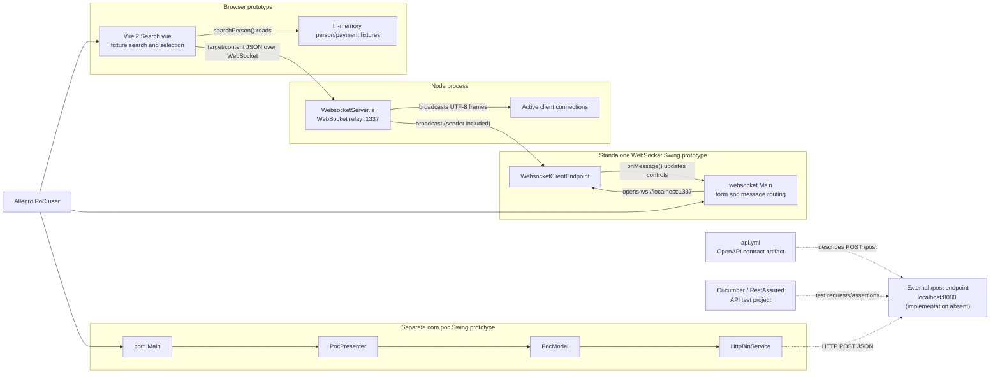
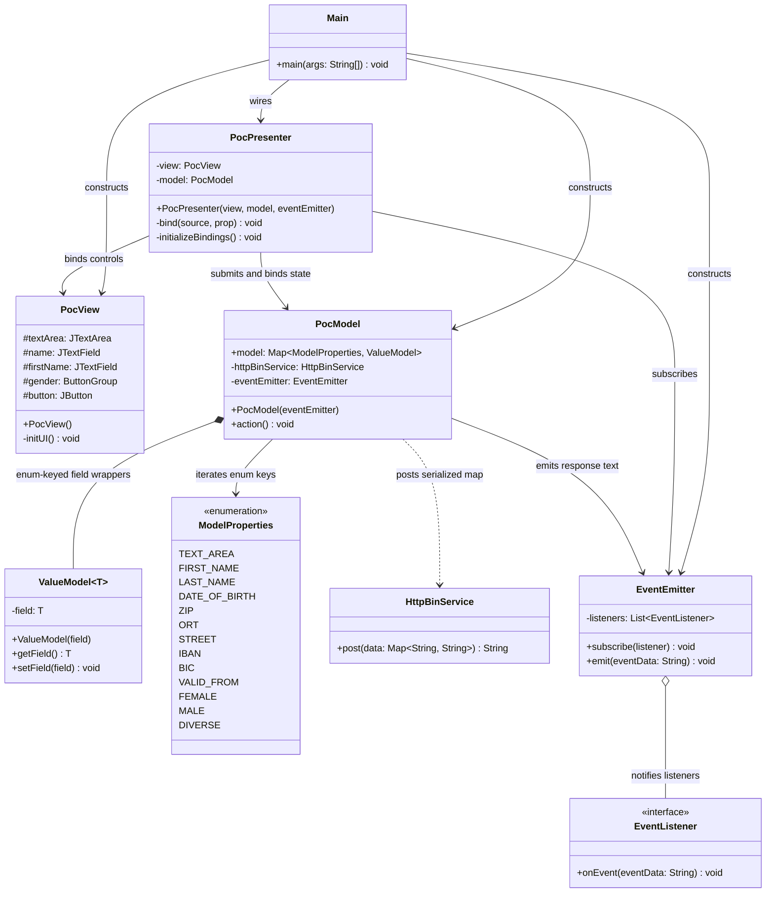
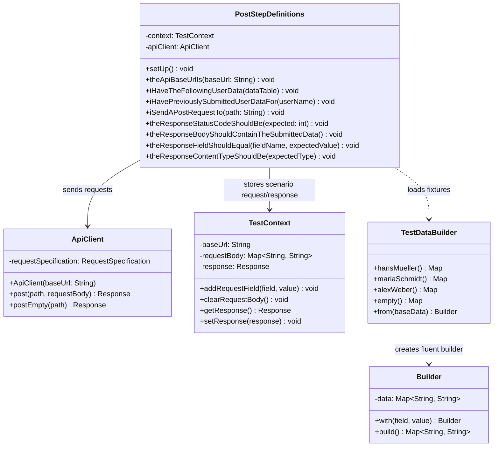
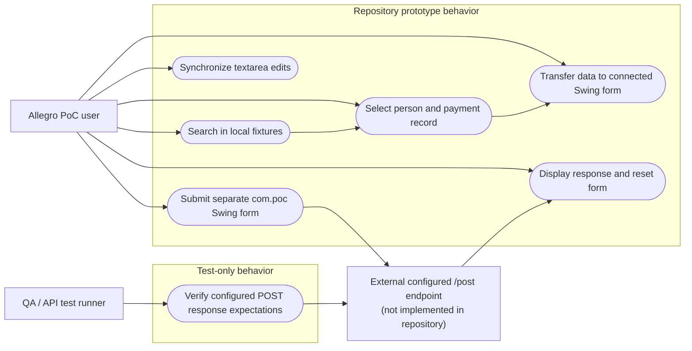

# UML Diagrams

## Scope and interpretation

These diagrams describe the inspected prototype source, not a single integrated production application. There are two independent Java Swing paths: `websocket.Main` receives WebSocket messages and populates a form; `com.Main` launches the `com.poc` presenter/model flow and posts to a local HTTP endpoint. The Vue component searches local fixtures and sends WebSocket messages through the Node relay. The repository does not contain the port-8080 POST server implementation.

The Cucumber/RestAssured project is test code expressing expectations about an endpoint; it is not that endpoint. No HR workflows, durable persistence, server-side business validation, or integration between the two Swing entry points is inferred. Dashed or explicitly qualified paths below indicate external dependencies, test expectations, or gaps rather than implemented local behavior.

- **Class diagrams:** 3 (Swing MVC, WebSocket receiver, API test support)
- **Sequence diagrams:** 3 (WebSocket handoff, Swing HTTP submission, API test execution)
- **Component diagrams:** 1
- **Use-case diagrams:** 1

---

## Component Diagram

### Prototype components and actual boundaries

The browser's search is performed over hard-coded Vue state. The Node process relays UTF-8 text to every currently connected WebSocket client, including the sender. The Java WebSocket form consumes the `target`/`content` envelope. Separately, `com.poc` submits a string map to the unimplemented local `/post` endpoint; `api.yml` and the API tests describe/test a contract but do not implement it.



**Boundary notes:** `websocket.Main`'s visible **Anordnen** button only logs a message; it is not wired to `PocModel.action()`. The two Swing entry points should not be treated as one application flow. The `/post` endpoint is external/absent in this repository.

---

## Class Diagrams

### `com.poc` Swing MVC and submission classes

This diagram shows the model/presenter application launched by `com.Main`. Only key fields and methods are shown. `ValueModel` wrappers hold individual form values. `ModelProperties` is the enum key set used when serializing the form. The event emitter holds listener references and invokes them synchronously.



**Implemented behavior / limits:** The presenter binds text and gender controls and resets them when an event arrives. `PocModel.action()` converts every enum field with `toString()` (null values can fail before HTTP), then delegates JSON POST to `HttpBinService`. The response-event logic is not equivalent to robust HTTP success validation: status is not checked, and I/O/read errors can prevent an event from being emitted. There is no backend validation shown.

### WebSocket Swing receiver

`websocket.Main` contains its own nested endpoint and lightweight parsed message/result holders. The endpoint is the Java WebSocket client; the top-level class owns the static Swing controls and routes recognized message targets. The Vue and Node sides are shown in the component and sequence diagrams rather than represented as invented Java classes.

```mermaid
classDiagram
    class WebsocketMain {
        -textArea: JTextArea
        -tf_name: JTextField
        -tf_first: JTextField
        -tf_dob: JTextField
        -tf_zip: JTextField
        -tf_ort: JTextField
        -tf_street: JTextField
        -tf_hausnr: JTextField
        -tf_ze_iban: JTextField
        -tf_ze_bic: JTextField
        -tf_ze_valid_from: JTextField
        +main(args: String[]) void
        -initUI() void
        +toSearchResult(json: String) SearchResult
    }
    class WebsocketClientEndpoint {
        -userSession: Session
        +WebsocketClientEndpoint(endpointURI: URI)
        +onOpen(session: Session) void
        +onClose(session, reason) void
        +onMessage(json: String) void
        +sendMessage(message: String) void
        +extract(json: String) Message
    }
    class Message {
        +target: String
        +content: String
        +Message(target, message)
    }
    class SearchResult {
        +name: String
        +first: String
        +dob: String
        +zip: String
        +ort: String
        +street: String
        +hausnr: String
        +ze_iban: String
        +ze_bic: String
        +ze_valid_from: String
    }

    WebsocketMain ..> WebsocketClientEndpoint : connects to localhost:1337
    WebsocketClientEndpoint ..> Message : extracts target/content
    WebsocketClientEndpoint ..> SearchResult : parses textfield payload
```

**Implemented behavior / limits:** `textarea` messages set the text area; `textfield` messages are parsed and mapped to a subset of the Java form fields. Unknown targets have no action. The receiver has no explicit schema validation or malformed-message recovery. Its submit button is not connected to the separate MVC submission model.

### API test support classes (test code only)

These classes build scenario state, send HTTP requests, and assert responses. The diagram does not imply that this repository supplies the API server.



**Test-only gap:** The “previously submitted” step loads a fixture into the current request state; it does not make a prior request or establish persistence. The tests assert behavior of a configured external endpoint.

---

## Sequence Diagrams

### Search and transfer through the WebSocket relay

Search runs locally against fixtures. A result row and payment row can be selected, then the transfer button sends a JSON envelope. Selection is not enforced: an empty `selected_result` or empty payment selection can be sent. The Node relay broadcasts text to all current clients, including the sender; the Vue client defines no inbound-message handler, while the Java endpoint handles the message if connected.

```mermaid
sequenceDiagram
    actor U as User
    participant V as Vue Search
    participant N as Node WebSocket relay
    participant J as Java WebSocket endpoint
    participant F as Swing form

    U->>V: Enter criteria; click Suchen
    V->>V: searchPerson() over hard-coded fixtures
    Note over V: Populated criteria use OR matching;<br/>postal code exact, text criteria substring
    V-->>U: Render matching result rows (or none)
    U->>V: Select person result
    V->>V: selectResult(item)
    opt User selects a payment beneficiary
        U->>V: Click payment row
        V->>V: zahlungsempfaengerSelected(item)
    end
    U->>V: Click "Nach ALLEGRO übernehmen"
    V->>V: sendMessage(selected_result, "textfield")
    Note over V: Deep-copy selected result and replace<br/>zahlungsempfaenger with selected object
    V->>N: JSON {target:"textfield", content:person}
    N->>N: Broadcast UTF-8 message to every connected client
    N-->>V: Same broadcast (no Vue inbound handler)
    alt Java client is connected
        N-->>J: Same broadcast
        J->>J: extract(json); toSearchResult(content)
        J->>F: Set mapped person/address/payment fields
    else Java client disconnected
        Note over N,J: No Java UI update
    end
    Note over V,N: No selection guard, schema validation,<br/>send readiness check, or offline queue
```

### Submit and reset the `com.poc` Swing form

Text and radio listeners keep model values synchronized with Swing controls. On **Anordnen**, `PocModel` iterates every `ModelProperties` member and converts values to strings. A null value can fail before the HTTP call. If the request returns normally, the model emits a response-derived event and the presenter displays it and resets visible fields.

```mermaid
sequenceDiagram
    actor U as User
    participant V as PocView
    participant P as PocPresenter
    participant M as PocModel
    participant H as HttpBinService
    participant API as External /post endpoint
    participant E as EventEmitter

    U->>V: Edit text or gender control
    V-->>P: Document/change listener callback
    P->>M: Update ValueModel for bound property
    U->>V: Click "Anordnen"
    V->>P: Button action
    P->>M: action()
    M->>M: Iterate ModelProperties; call value.toString()
    alt Any value is null
        M-->>P: NullPointerException propagates before request
        Note over P,API: No HTTP request or normal response event
    else All model values are non-null
        M->>H: post(string-valued field map)
        H->>API: HTTP POST /post (application/json)
        API-->>H: HTTP response
        H-->>M: Read response body
        alt Non-empty body returned
            M->>E: emit(responseBody)
        else Empty body returned normally
            M->>E: emit("Failed operation")
        end
        E-->>P: Invoke subscribed callback
        P->>V: Display event text; clear fields; select female
    end
    Note over H,API: Endpoint implementation is absent here;<br/>HTTP status is not used as the model's success decision
```

**Failure qualification:** `HttpBinService` reads `getInputStream()` and takes the first scanner token. HTTP/I/O failures (and empty-stream read behavior) may throw before `PocModel` emits an outcome; the presenter wraps request exceptions as runtime failures. The empty-body event branch describes the model's conditional if a normal empty string is returned, not a guarantee for every empty HTTP response.

### Cucumber API test request and assertions

This sequence represents only the repository's API test code. The server is an external configured target, not implemented by the test project or the Node WebSocket relay.

```mermaid
sequenceDiagram
    participant R as Cucumber runner
    participant S as PostStepDefinitions
    participant C as TestContext
    participant D as TestDataBuilder
    participant H as ApiClient
    participant API as Configured external API

    R->>S: Start scenario
    S->>C: Clear request body
    S->>C: Set base URL / initialize client
    opt Scenario uses named persona
        S->>D: Resolve fixture map
        D-->>S: Return sample fields
        S->>C: Store fixture as request data
    end
    opt Scenario supplies data table
        S->>C: Add request fields
    end
    S->>C: Read request body
    alt Request map empty
        S->>H: postEmpty(path)
        H->>API: POST {} as JSON
    else Request map populated
        S->>H: post(path, requestBody)
        H->>API: POST JSON map
    end
    API-->>H: HTTP response
    H-->>S: RestAssured Response
    S->>C: Save response
    S->>S: Assert status/body/field/content type
    Note over S,API: Assertions describe expectations only;<br/>the suite has no server or persistence implementation
```

---

## Use-Case Diagram

### Prototype user goals and test-only endpoint interaction

The user can search the Vue fixture list, select a record/payment entry, send it to a connected Swing receiver, edit shared text, or use the separate MVC Swing form's HTTP submission path. API tests are shown as a QA actor against a configured external API. This does not assert that the endpoint exists locally.



**Not implemented/inferred:** No use case here implies durable storage, update semantics, backend validation, or a production Allegro/HR integration. In particular, test wording about previously submitted data is implemented as fixture setup, not a persistence feature.
